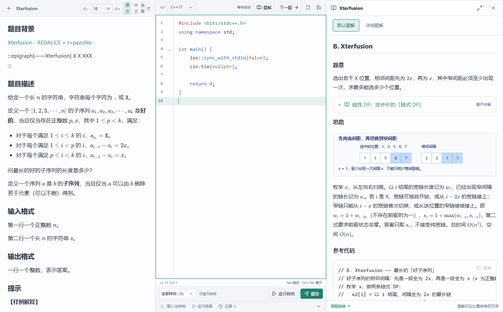

# ToBe · Training Workbench

The additional growth and administrator changes have passed isolated checks and are not in the installed administrator package yet: portrait/rank and XP stay above a compact six-stat row; the bottom target icon reveals goal controls; King artwork and the highest difficulty medal use pale gold metal. Independently authenticated administrators can read other profiles and avatars while the service excludes administrator roles before ranking and future rewards. Backend checks: 1,080 passed, 2 skipped and one existing delegated teaching-ledger digest failure out of 1,083; eight light/dark responsive layouts, the full app UI and 42 service API tests passed. Retained-data frozen user launches measured 5.45/6.55 seconds; the three-second target remains unmet. [Evidence](docs/verification/growth-material-current.json).

**Current source: 1.5.1; the local upgrade and task-card follow-up are installed, with no public release.** Full-window learning tabs offer cross-section search, folder browsing, independent editor groups and saved learning positions. Comments support direct replies and owned-sticker gifts. Pending achievements preview fixed stickers, badges or XP; each level from five grants a manually opened box with level-dependent size and odds. Plain XP cards retain their original appearance, with restrained rarity tints only for explicit sticker rewards. See the [delivery evidence](docs/verification/learning-browser-current.json). Shared-service candidate 1.4.1 remains undeployed; persistent replies, gifts and box delivery require that service update. [Scope, reward rules and validation](docs/releases/1.5.1.md).

The recommendation header and dropdown no longer show right-side information circles. The installed frontend and normal installer use `54646f49`; recommendation selection and keyboard interaction remain available. Shared-service deployment is authorized, but SSH key exchange is timing out; no runtime upload, production switch or database mutation has occurred. Desktop 1.5.1 and service 1.4.1 have independent version numbers.

**1.5.0 baseline, not publicly released.** This window continues OI Wiki, real two-player online duels, account-owned stickers, fun/hidden achievements and the requested startup/UI repairs. The King tier begins at ability score 2000. The user delegated core-seven editorial continuation and the complete living-template work to other windows; received work remains preserved for final integration. The 1.4.36 repair baseline `6907a654` and the final locally delivered 1.4.37 `9f10b378` are merged, preserving all repairs. Downloads still point to published builds. [Development and verification](docs/releases/1.5.0.md).


Final follow-ups preserve complete language/template labels, move Ln/Col into the run toolbar, keep sidebar icons fixed through both animation directions, highlight entire recommendation rows, support font-wheel steps, shorten the duel label and retain OI Wiki credits/licensing in a separate information dialog. Of 1,068 backend checks, 1,065 pass, two skip and one delegated teaching-ledger digest mismatch remains recorded. The complete production backup was restored on isolated MySQL 8.4.11; repeatable migration and runtime rollback preserving new data passed. Production and public distribution remain unchanged; final installed startup evidence is recorded separately.
The prior 1.5.0 upgrade, startup and preservation checks remain in the [baseline evidence](docs/verification/next-150-current.json). Local 1.5.1 starts from the normal entry; all 4,765 program files match their manifest, and identity, drafts, training, submissions and XP ledgers are preserved. The native core is `357dd947`. Shared-service deployment and public downloads remain unchanged.

Maintenance changes avoid repeated work on unchanged account state and postpone auxiliary startup jobs. Administrator identity/growth now agree; up to five independent registration-test workspaces support level changes and upgrade simulation. Private administrator 1.5.1, built from `53938d41`, passed isolated fresh installation, a 1.4.37 upgrade and an ordinary local launch with complete accessible navigation. Eight private databases were protected by verified online backups including committed WAL; the real prefix-sum program passed all 24 local judge cases. The integrated 1,081-check run has 1,078 passes, two skips and one delegated teaching-ledger digest failure. The other window delivered user build `54646f49`; this window did not reinstall it. Administrator backend readiness of 1.36 seconds does not establish user-content timing: historical retained-account results remain 5.63 / 8.33 seconds, above the three-second target. Production remains 1.2.9. The other window is authorized to deploy the service but is blocked by SSH connectivity; no service deployment or public release is claimed. [Evidence and limits](docs/verification/next-150-current.json).

The isolated development seed was rebuilt and checked: 12,317 problems, 12,218 statement archives, 1,939 default editorials, 1,938 detailed editorials, 480 lectures and 9,258 relationships. It preserves the locally delivered school training, Weekly 168, ABC 482, White Monthly 139 and Div.3 1131, including their identities, prose and images. Div.3 A adds a default editorial only; existing detailed editions remain intact. These source counts do not imply a personal-data or public-download update.

The 1.4.37 continuous knowledge journey, prerequisite curriculum, recommendations and level-one teaching access remain available, with existing progress, drafts and content identities preserved. Reading and guided ACs do not directly prove mastery. [Delivered repairs](docs/releases/1.4.37.md).

The final 1.4.36 repairs were continued in 1.4.37 and fully merged here; this historical record does not describe an active old installation. Bounded update backups, explicit retry, workbench controls, native fullscreen, original-site receipts and ability evidence remain preserved. [Original repair scope](docs/releases/1.4.36.md).

**1.4.35 is installed and verified locally, not publicly released; domestic stable remains 1.4.34.** Workbench edges, corner back clicks, the continuous 1px separator, stronger center snapping, a borderless px font control and transparent Ln/Col text are fixed. All 975 backend checks passed; both local editions preserve identity, drafts, training and existing XP. Future releases default to verified incremental updates. [Delivery](docs/local-delivery-1.4.35.md).

**Domestic stable 1.4.34 was published on 2026-11-01; both local editions are updated.** This revision aligns workbench typography and control backgrounds, adds wheel font adjustment, inline sample/custom/run controls, Alt+T toolbar locking and Ctrl+Right navigation, and removes visible lock/fold controls. Recommendations, template naming and adjustable theme previews use less space; title medals use restrained engraved metal and enamel. An incompatible delta falls back to a verified full installer, and preparation errors no longer look like active-contest waits. [Scope](docs/releases/1.4.34.md). Service 1.3.0 remains local only; the four next-version features remain queued.

New Lv.1 beginners unlock levels 2–5 at 200/600/1200/2000 cumulative XP. Existing account levels, XP and veteran assessments retain their original rules. All 12 Gym 728862 tasks and paired editorials already installed locally are included in the updated source and public seed.

**Local 1.4.33 was validated and is now superseded by domestic 1.4.34.** Fresh installation, upgrade, the private administrator program and personal-data preservation were checked. [Local delivery and verification](docs/local-delivery-1.4.33.md). Settings → Appearance → Code themes offers 22 palettes plus automatic UI matching, a scrollable left selector and live code preview. Woodfish-inspired gradients, subtle glow, a colored caret and editor glass adapt independently to light and dark UI. [Scope](docs/releases/1.4.33.md).

Achievements now require an explicit reward claim and keep previous awards. Difficulty milestones span 1500–2300 and grant medals, with additional time, daily submission/AC/WA, spaced-review and social milestones. Training clearing preserves review schedules; ordinary problems join training on the first actual edit. Catalogue loading, synchronized settings, the startup window, images and caret are refined. Service 1.3.0 is an undeployed candidate; leadership streaks and shared public translations require that service.

This update also adds five-minute contest reminders and live statement import, a level-five assessment for experienced users, and offline Ctrl+S formatting in ordinary practice. It fixes AtCoder submission readiness and feedback, caret visibility and learned-state icons, and removes the activity feed below rankings.

**ToBe 1.4.31 is publicly released.** Local 1.4.30 was upgraded; GitHub and domestic user builds match. Service 1.2.9 is reused without deployment. No new content feed. [Delivery](docs/local-delivery-1.4.31.md).

Local 1.4.30 teaching update: a complete XOR-basis template and 15 reusable operation lessons organized into Templates and Algorithm Lab. There are 28 templates and 17 lab topics. Teaching editions pair explanations with code; contest editions keep compact implementations. Original lecture records, illustrations, editorial links and learning history remain intact. This revision is included in the published 1.4.31 build. [Scope and validation](docs/algorithm-learning-organization.md).

Local 1.4.30 UI revision (2026-10-30): account-owned confirmed navigation avoids the three-item startup flash; ranking avatars persist across periods and recover after transient failures; leaving a contest problem restores its contest and scroll; knowledge chips filter the library; Latin runs use equal advance widths across library, contest and training-list catalogues. The 195-problem / 206-method / 412-article editorial batch is retained; the 610-problem request remains incomplete. This local revision is unpublished; public downloads remain at 1.4.29. [Changes and validation](docs/local-delivery-ui-followups.md).

Local 1.4.30 content revision (2026-10-30): all 201 currently catalogued Lanqiao tasks across 34 contests have default and detailed reading entries. This adds 97 distinct source problems / 99 editorial pairs and preserves all 1,516 installed pairs. Source ambiguities and algorithm limits are stated in each article; the general maximum constraints of P16802 remain unresolved. At delivery, that batch had 12,271 problems, 9,436 statements, 1,615 editorial pairs, 462 lectures and 564 lists. English opens in English; the existing toggle reveals Chinese, including the 361 bundled ABC / CF Div.2 / Div.3 / Div.4 translations. This local update is unpublished; public downloads remain at 1.4.29. [Scope, checks and limits](docs/local-delivery-lanqiao-all.md).

Local editorial batch (2026-10-30): 195 problems, 206 methods and 412 distinct default/detailed articles cover the programming stage, simulation/enumeration, sorting, 17 greedy/construction exercises, recurrence, recursion, divide-and-conquer, prefix sums, difference arrays, binary search, two pointers and the first search unit. The seed now contains 12,271 problems, 9,436 statements, 1,674 editorial pairs and 467 lectures. The full 610-problem request remains incomplete. English-first display and offline Chinese switching are preserved. This batch is local and unpublished; public downloads remain at 1.4.29. [Scope and validation](docs/local-delivery-core7.md).

Local statement-language patch for 1.4.30 (2026-10-30): English statements always open in English. Click the existing language toggle for Chinese. All 361 current ABC / CF Div.2 / Div.3 / Div.4 statements include verified offline Chinese text (94 / 100 / 86 / 81); four fetched originals received matching translations, with the previous text retained in archives. Existing mainline translations remain available. The local patch is unpublished; public downloads remain at 1.4.29. [Rules and validation](docs/local-delivery-english-first.md).

**ToBe 1.4.29** connects evidence-based Rasch assessment, level-aware learning paths, protected offline work, bounded backups and public content updates. QOJ now includes the complete 13-task Shandong Provincial 2026 contest. [Release notes](docs/releases/1.4.29.md).

**ToBe 1.4.28** adds page-wide calendar arrow navigation with automatic detail-row positioning, removes empty contest folders, opens lectures in a full-app reading layout, accelerates daily reward claims, and remembers only Appearance settings position. [Release notes](docs/releases/1.4.28.md).

**ToBe 1.4.27** shows aligned guide cards with existing page icons. New and existing accounts automatically see the guide on first sign-in; registration signs in automatically, and a per-account acknowledgement prevents repeats. [Release notes](docs/releases/1.4.27.md).

**ToBe 1.4.26** repairs updates before login and old saved-session recovery, removes missed foreign contests, and aligns the template, laboratory, submission and growth views. [Changes and validation](docs/releases/1.4.26.md).

**ToBe 1.4.25** adds direct page-number navigation and complete contest routes by ICPC/CCPC series and provincial/invitational type. Years follow the available contest records, including 2026. Earlier templates, review rewards, chunked sync and catalogue scope remain available.

**ToBe 1.4.20 (included in the current release)** repairs shared browser connection recovery, refines difficulty estimates and excludes elementary exercises from automatic review. It adds list filters, insertion ordering, a favorite-problems list, cached reversible likes and inline creation, single-column mock papers, accent-based activity levels and bounded statement/streamed sync memory. [Release scope](docs/releases/1.4.20.md).

Includes algorithm topics, training lists, illustrated editorials and interface fixes previously delivered locally in 1.4.2–1.4.24. The published 1.4.34 public seed retains 12,294 original problem records, 12,195 statement archives, 1,686 default/detailed editorial pairs, 467 lectures and 564 lists. Archived statements are not all complete or readable; see the [current release scope](docs/releases/1.4.34.md) and [earlier statement audit](docs/releases/1.4.17.md). QOJ has 76 source records, including the complete 13-task Shandong Provincial 2026 and 13-task Changchun Regional 2026 sets. Changchun D is interactive and I is communication; their special types are preserved, and the set is not offered as an ordinary mock contest. The separate full editorial review remains incomplete.

<!-- release-status:start -->
**Domestic stable: [ToBe 1.4.34](https://47.82.84.74/updates/stable/release-1.4.34.html). GitHub binary releases remain at 1.4.32; [1.4.34 source](https://github.com/3097729287/acm-algo-trainer/tree/v1.4.34) is public.**
<!-- release-status:end -->

[Website](https://3097729287.github.io/acm-algo-trainer/) · [Usage](docs/usage.md) · [Development](docs/development.md) · [中文](README.md)



## Install and upgrade

Windows 10/11 x64. The [user installer](https://47.82.84.74/updates/assets/1.4.34/ToBe-Setup-1.4.34-win64.exe) includes the C++ compiler, Python 3 runtime and offline WebView2 runtime. Fully extract the [GitHub 1.4.32 portable archive](https://github.com/3097729287/acm-algo-trainer/releases/download/v1.4.32/ToBe-1.4.32-win64.zip) before running it. GitHub distributes only the user edition. The administrator program is reserved for the owner’s local use. Release assets include checksums and a [full update for older versions](https://47.82.84.74/updates/assets/1.4.34/ToBe-Setup-1.4.34-win64.exe). Older versions can use the full Setup. The administrator edition is a local program and shortcut only.

Save drafts and exit TB before installing into the existing directory. Personal databases, source code and imported content are preserved. The updater saves work, takes online SQLite backups and verifies SHA-256 before replacement. Keep the same TB version on your computers. Original-site login uses TB's dedicated browser profile; no extension is required.

## Changes in 1.4.29

All navigation, guides, shortcuts and dependent actions share one level-unlock configuration; new accounts start with introductory lists. Recommendations use actual review, prerequisite and independent-attempt evidence. Previously verified, unexpired accounts can continue cached study offline and merge before uploading when connectivity returns. Automatic backups retain validated WAL-inclusive recovery points under count/capacity limits, with manual copies protected.

More translations, manual difficulty reviews, Nowcoder lists and teaching content continue in batches. Compatible public content can update while the service stays online; new interactive course behavior and program features require an application update. All remote CI jobs passed for the released build ([Actions](https://github.com/3097729287/acm-algo-trainer/actions/runs/40850211153)). The shared service remains 1.2.8; the administrator program stays private, and no real OJ test submissions were sent.

## Changes in 1.4.26

- Updates remain available while a saved login is restoring. Service 1.2.8 lets old clients leave incompatible restore loops and use their existing updater before login. Private state is preserved.
- Samara, Brazilian/UFBA and other missed foreign XCPC entries are excluded after final source normalization. Submission history and code remain available.
- Template and laboratory cards share centered headings and hover/focus highlighting; submission code icons sit beside verdicts; the growth panel uses its height more evenly.

## Changes in 1.4.25

- Enter a page number and press Enter to jump. Contest folders expose existing 2026 records through ICPC/CCPC and provincial/invitational routes.
- Twenty-four templates include explained and short competition versions, plus 48 operation exercises judged inside the app. Initial code is customizable through a preview picker; account settings open from the nickname.
- Official WA schedules next-day review; eligible completion earns 20 XP. Daily AC, review and study-time task chains advance after claiming rewards.
- Chunked synchronization and on-demand historical code loading preserve local code and drafts. All devices on migrated accounts must upgrade.
- Calendar, template and laboratory layouts, source cleanup, XCPC scope and list difficulty limits include the preceding local updates. Source-backed difficulty and knowledge reviews continue in the current release series.

## Changes in 1.4.1

- Immersive Algorithm Lab with larger, consistent text and compact top navigation. Short absences restore position; three minutes away returns to the course entry while preserving drafts.
- Shared dual-thumb difficulty ranges with exact values. The library dice selects uniformly from every filtered match, allows repeats and ignores pagination. Remove the duplicate random mock mode.
- A larger single-month activity calendar, immediate arrow-key selection and a compact date/AC header. Always-visible details paginate to available height; private statistics move into Settings.
- Shared topic hierarchy and parent scope fix missing counts. Split geometry into subtopics and review 67 exact-source annotations. Current unique-library counts: LCM 17, compression 10, linked lists 3 and interactive tasks 25; this is not a full manual editorial review.
- Foundations default to ascending difficulty, show the primary topic only and link secondary foundations at the beginning of the reader. A topic icon opens the folder picker directly.
- Nine original rank designs, warm practice flames, compact contests, indexed submission records, all four visual styles, aligned metrics and period-specific received hearts.
- Consistent settings pages, a visible update button, refined dinosaur/orbit animation and special thanks. Saved-login restoration uses a loading screen. Fix the Setup internal error during legacy-record detection.
- The owner receives a local administrator program and shortcut, without an administrator installer or archive. 612 backend checks, full frontend CI, native windows, fresh install/uninstall, a 1.4.0 upgrade and actual incremental application passed. [CI](https://github.com/3097729287/acm-algo-trainer/actions/runs/39919816597).

## Changes in 1.4.0

- Wider C++ knapsack lessons, right-side navigation and a final-lesson handoff to five guided problems. Navigation surfaces follow page opacity.
- Folder filters for contests and lectures, aligned counters and controls, and a spaced heart “and” comment heading.
- Direct original-site login with automatic continuation of the current unsent submission; native verification and single-send protection remain.
- Cached repeated workspace/analytics reads and compressed catalogs; faster recognition after account validation completes.
- 603 backend checks, complete frontend/CI, native browsers, fresh install, upgrades and three actual incremental paths passed. [CI](https://github.com/3097729287/acm-algo-trainer/actions/runs/39849264029).

## Changes in 1.3.4

- Adaptive reviews start the day after an official AC with an isolated blank draft, then adjust intervals to difficulty, independent success and failures. Easy tasks can leave long-term review; heavy review days reduce new work. Original code and history remain intact. [Rules](docs/adaptive-reviews.md).
- A footer calendar dialog shows upcoming basic contests from four official platforms in Beijing time, with background refresh and cached offline access. Indexed radar summaries avoid repeated full-library scans.
- Canonical original-task deduplication retains aliases, drafts and receipts. Next-problem navigation saves before switching; the editorial button toggles its stable-width reader. Folder filters, tables, headers and confirmations align consistently.
- Cancelling a contest produces no completion or make-up tasks and retains code and genuine receipts. Extract 24 linked foundations, bringing lessons to 400. The knapsack DP course is distributed as a separate preview and is not integrated into the application.

## Changes in 1.3.3

- Search bars place the direction toggle before filters, with matching default colors. Changing direction alone does not show a filter indicator.
- Uniform spacing on all four workspace edges also applies to large windows. Settings tiles, credits and translation panels fit the available height and preserve their bottom corners.
- 1,262 existing English statements default to Chinese: 1,260 new prebuilt translations and two retained original-site Chinese texts. Formulas, pseudocode, samples and limits are preserved, with an original-language toggle and no translation API request during reading.
- Radar, library and filters share canonical topic names and categories. Enumeration belongs to reasoning and strategies, and Escape returns from the secondary radar. Mastery accounts for quantity and difficulty; parent domains require sufficient evidence for each child instead of reporting high confidence from a few easy problems.
- Contest folders and replay selectors default to newest first. ARC, AGC, CCPC and online qualifiers remain discoverable, empty series are identified, and Lanqiao B is independent of the hosting platform. Replays hide header search and ignore single-problem difficulty presets when selecting whole contests.
- One-line list footers move page size into interaction settings. Level and XP align, larger statistic icons expose tooltip labels, hearts share a column, and switches have circular pill shapes.
- User APIs refuse ranking deletion. The owner’s local administrator tool has separate data and identity, requires server authorization for public management and never uploads test progression. It is not publicly distributed.
- New accounts automatically receive the introductory walkthrough. Settings → Data and Help → New User Guide contains detailed page guides for avatars, radar, tiers, achievements, goals and practice, without additional page buttons. Credits add NiuXyn.

## Changes in 1.3.2

- Compact navigation removes page breadcrumbs. The uppercase TB mark toggles the sidebar; settings subpages have a return arrow and Escape navigation, tooltips for explanations and solid configuration panels. Sync indicators keep a fixed position.
- Daily goal problems move into My Training. Queue headings align left, outlined themes border individual problems and rounded surfaces clip square overflow. Remove redundant submission symbols and approximate difficulty prefixes.
- Browse contests, replay events and topic selections through nested folders. Parent topics are selectable, active topic filters can be cleared in the header, and ordered lists expose a direction button beside search.
- Mock history appears below setup, newest first. Single problems default to 30/45/60/75 minutes by difficulty; topical and comprehensive durations follow difficulty and problem count. Replays use the original duration; manual values are retained.
- Every timed mode submits through the original-site browser workflow. The problem menu escapes toolbar clipping, timer and finish controls sit at the upper right, and the editor keeps autosave without import/save buttons or a focus outline.
- Knowledge mastery weights judged success, independence, submission stability and difficulty. Fewer than five distinct judged problems or three rated problems displays `?%`. Parent topics deduplicate shared evidence; adding unused catalog problems cannot reduce mastery.
- Compact standings, restored AC colors, larger counters, filled hearts, consistent flame icons, symmetric rank medals and refined avatar frames. XP rings grow clockwise from the bottom. Achievement icons reflect their meaning, goal controls move into the account panel and credits use larger, colored names.
- Each settings tile has a distinct, centered animation suited to its space: a detailed dinosaur turns at the edges, balloons rise through a tall tile, clouds cross a wide tile, varied buildings surround a planet with a slower explosion and rebuilding cycle, and the bulb glows gently.

## Changes in 1.3.1 (released baseline)

- Search and filter share the top bar without covering status controls. Favorites and sorting move into the filter; contests default to a list.
- The AC indicator shows the pre-today baseline and today's count, e.g. `AC:82` or `AC:82+2`. Static sketch flames and decorated rank avatar frames replace the previous artwork. Growth combines account statistics and radar details.
- Four training modes share generate/start controls and direct topic/event selectors. Presets are 1000–1400, 1300–1700, 1600–2000 and 1900–2200. Dropdown popups no longer close before selection.
- Editable keyboard shortcuts support conflict detection and reset. Navigation labels, groups and order share one editor; settings breadcrumbs and Escape return to the settings home.
- Page opacity works at 0–100%, including lists, statements, editor and editorials. Practice fills the client area; the back arrow or Escape restores navigation.
- Wider standings put medals first and interactions last. Your own heart is colored with no self-comment button. The activity section stays present and contains only the current Beijing date. Deletion uses an anchored confirmation.
- Settings tiles fill the available space with refined dinosaur, cloud, bulb and planet animations. Credits are centered and enlarged; notifications no longer include update configuration.
- Account settings display authenticated local identity immediately. Minimize/restore stops changing main WebView visibility. Renderer exits receive bounded recovery and a visible fallback; draft journals remain intact.

## Library and progression

The public seed contains **12,271 original problem records, 9,436 statement archives, 1,674 default/detailed editorial pairs, 467 lectures and 564 lists**. Archiving does not imply every task is complete or runnable. QOJ has 76 source records, including the complete 13-task Shandong Provincial 2026 and 13-task Changchun Regional 2026 sets. Changchun D is interactive and I is communication; their special types are preserved, and the set is not offered as an ordinary mock contest. Existing content, aliases, code and drafts are retained. Verified difficulty at most 2300 is the scope for new translations and non-XCPC editorials; unknown ratings require evidence, and new XCPC editorials remain deferred. [Editorial policy](docs/editorial-policy.md).

XP levels and skill tiers are independent. The 1.4.29 assessment shares the knowledge-mastery Rasch model, using recent independent judged attempts, rating reliability and retry evidence, with conservative estimates, uncertainty and per-problem provenance. Earned XP and rewards are preserved. Placement unlocks at level 5 and requires five independent successes. Iron through King starts at **0, 800, 1000, 1200, 1600, 1800, 2000, 2100 and 2200**. This is a training estimate, not a direct copy of an original-site account rating. [Progression rules](docs/progression.md).

Only official AC receipts count as accepted problems. In 1.3.2 every timed mode submits through the original-site browser; local sample runs and historical local records retain their actual scope. Standings display separate level and ability information, daily hearts and private messages.

## Data and development

Account sync preserves training, complete submitted source, drafts, goals, XP, favorites and preferences. Conflicting drafts are retained separately. Site cookies stay local; translation keys use Windows DPAPI. JSON export excludes passwords, cookies and API keys.

```powershell
python backend/backend.py --offline
# In another terminal
cd frontend
npm ci
npm run dev
```

[Accounts](docs/accounts.md) · [Architecture](docs/architecture.md) · [Build and release checks](docs/development.md) · [Earlier releases](https://github.com/3097729287/acm-algo-trainer/releases)
