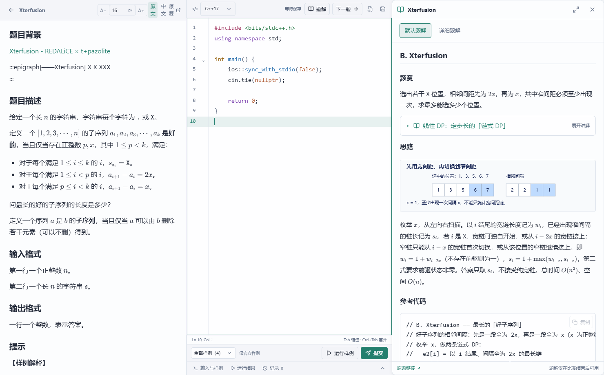

# TB · 训练工作台

TB 将题库、图文题解、C++ 编辑、本地评测和训练记录放在同一个工作台，支持 Codeforces、AtCoder、牛客和洛谷。本机 SQLite 保存代码与待同步记录，账号服务支持跨电脑恢复。

<!-- release-status:start -->
**TB 1.2.1 已正式发布。** [下载新版](https://github.com/3097729287/acm-algo-trainer/releases/tag/v1.2.1) · [变化与验证](docs/releases/1.2.1.md)。桌面程序和共享服务均已更新并通过验证。
<!-- release-status:end -->

[项目主页](https://3097729287.github.io/acm-algo-trainer/) · [使用说明](docs/usage.md) · [开发与构建](docs/development.md) · [English](README.en.md)



## 安装与更新

Windows 10/11 x64。[安装包](https://github.com/3097729287/acm-algo-trainer/releases/download/v1.2.1/TB-Setup-1.2.1-win64.exe)包含 C++ 编译器和离线 WebView2；[便携版](https://github.com/3097729287/acm-algo-trainer/releases/download/v1.2.1/TB-1.2.1-win64.zip)需要完整解压。发布页提供校验清单和对应版本的增量包。

保存草稿并退出 TB 后安装到原目录，个人数据库、代码和导入内容保留。自动更新会先保存草稿、在线备份 SQLite、验证 SHA-256，再替换程序。跨电脑使用同一账号时，各电脑应升级到同一版本。原站登录保存在 TB 专用浏览器中，无需扩展。

## 1.2.1 的变化

- **设置分层与记忆：** 一级菜单汇总外观、交互与导航、更新、训练与筛选、数据与帮助、翻译 API；点击进入详细设置。切换页面后返回，保留所在分类与滚动位置。鸣谢显示在设置首页下方；点击右上角头像即可选择或删除图片。
- **透明度与风格：** 全局与每页不透明度均支持 0–100%，各页选项始终展开，可一键重置。清简、线框、极光、蓝图有各自可见的轮廓与纹理。
- **文件夹与知识点：** 题库和比赛共用深层分类，如「牛客 → 练习赛 → 练习赛 153」和「XCPC → ACM → CCPC → 2025年 → 区域赛 → 正赛 / 热身赛」。优先使用已有比赛元数据，未知年份保留待核实。知识点抽屉默认收起，展开时平滑替换主导航。
- **专注训练：** 侧栏缩窄、选项留出间距；未提交题只显示灰点。模拟赛使用短输入、紧凑布局与悬浮说明；榜单和提交记录去除重复文字。每日任务、成就与时钟放在右下方，进入做题界面时自动隐藏顶栏和底栏。
- **当日状态：** 顶部用 `AC: 数量` 和 `♡: 数量` 展示今日通过与今日收到的爱心；AC 颜色随数量增强。每日爱心以北京时间结算，累计收到的爱心仍在通知中保留。
- **段位与入门：** 王者门槛调整为能力分 **2200**，其他门槛同步下调。已有能力分重新对应段位，经验不变。新手指引高亮真实操作区域，等待实际打开练习和返回，再介绍提交记录、模拟赛与设置。

## 题库与成长

公共种子包含 **5819 题（5646 可见、173 隐藏）、2422 份题面、1302 份默认题解、1302 份详细题解、376 篇讲义**。未缓存的题面仍需联网读取；所有已有内容保留。新增题解只限难度严格低于 2200，未知难度先核验。[题解政策](docs/editorial-policy.md)。

经验等级和能力段位分别成长。5 级解锁段位，至少 5 道已验证独立首次官方 AC 后，取最高 5 题难度的中位数作为能力分。门槛依次为 **0、800、1000、1200、1400、1600、1800、2000、2100、2200**，对应黑铁至王者。这是题库训练尺度上的参考值，非直接使用原站账号 rating。[完整规则](docs/progression.md)。

原站 AC 才计入通过成绩；运行公开样例不会冒充 AC。重现赛通过原站表单提交，盲组题训练使用其标注的本地评测范围。排行榜显示等级与能力段位，支持每日一次爱心和私密留言。

## 数据与开发

账号同步包括训练、完整提交代码、草稿、目标、经验、收藏和偏好；冲突草稿另存。原站 Cookie 与翻译密钥不进入公共题库，翻译密钥使用 Windows DPAPI 保护。设置中的数据导出为 JSON，不含密码、Cookie 或 API 密钥。

```powershell
python backend/backend.py --offline
# 另一个终端
cd frontend
npm ci
npm run dev
```

[账号与同步](docs/accounts.md) · [架构](docs/architecture.md) · [构建和发布检查](docs/development.md) · [1.2.0 本机交付记录](docs/releases/1.2.0.md) · [历史发布](https://github.com/3097729287/acm-algo-trainer/releases)
