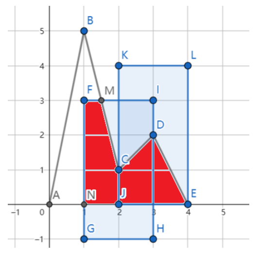

# Mountain

Time limit: $1$ second. Memory limit: $512$ MB. Standard input and standard output.

DreamGrid is climbing a mountain. The mountain is the region between the x-axis and the polyline

$$
(0,0)-(1,h_1)-(2,h_2)-\cdots-(n,h_n)-(n+1,0).
$$

For each integer $i$ with $1\leq i\leq n$, DreamGrid takes a picture at $(i,h_i)$. It covers the rectangle consisting of all points $(x,y)$ satisfying $i-W\leq x\leq i+W$ and $h_i-H\leq y\leq h_i+H$.

His hard disk has limited space, so he can keep only $K$ pictures. He wants to maximize the area of the mountain covered by at least one kept picture. Find the maximum area for every $K=1,2,\ldots,n$.

In the diagram, $n=3$, $W=1$, and $H=2$. The mountain's polyline is `A-B-C-D-E`. Keeping the $2$ pictures at `C` and `D` covers the red polygon `F-M-C-D-E-N-F` inside the mountain.

## Input

The first line contains three integers $n,W,H$ ($1\leq n\leq 200$, $1\leq W\leq 5$, $1\leq H\leq 10\,000$), describing the number of points and picture dimensions.

The second line contains $n$ integers $h_1,h_2,\ldots,h_n$ ($1\leq h_i\leq 10\,000$), the y-coordinates of the mountain points.

## Output

Output $n$ lines. On line $i$, output the maximum area for $K=i$ as a floating-point number. The absolute or relative error must not exceed $10^{-6}$.

Formally, if your answer is $x$ and the jury's answer is $y$, it is accepted if and only if

$$
\frac{|x-y|}{\max(1,|y|)}\leq 10^{-6}.
$$
