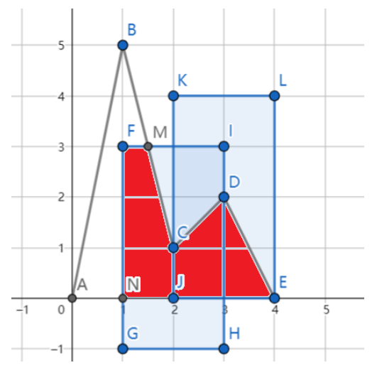

# Mountain

时间限制：$1$ 秒。内存限制：$512$ MB。使用标准输入和标准输出。

DreamGrid 正在爬山。这座山是平面上以下折线与 x 轴围成的区域：

$$
(0,0)-(1,h_1)-(2,h_2)-\cdots-(n,h_n)-(n+1,0).
$$

对于每个满足 $1\leq i\leq n$ 的整数 $i$，DreamGrid 都在 $(i,h_i)$ 处拍摄一张照片。该照片覆盖一个矩形，包含所有满足 $i-W\leq x\leq i+W$ 且 $h_i-H\leq y\leq h_i+H$ 的点 $(x,y)$。

由于硬盘空间有限，他只能保留 $K$ 张照片。他希望至少被一张保留照片覆盖的山体面积尽可能大。请分别求出 $K=1,2,\ldots,n$ 时能覆盖的最大面积。

图中 $n=3$、$W=1$、$H=2$，山体的折线为 `A-B-C-D-E`。保留在 `C` 和 `D` 处拍摄的 $2$ 张照片后，山体中被覆盖的部分就是红色多边形 `F-M-C-D-E-N-F`。

## 输入

第一行包含三个整数 $n,W,H$（$1\leq n\leq 200$、$1\leq W\leq 5$、$1\leq H\leq 10\,000$），分别描述山体折线中的点数以及照片的覆盖范围。

第二行包含 $n$ 个整数 $h_1,h_2,\ldots,h_n$（$1\leq h_i\leq 10\,000$），表示各山体点的纵坐标。

## 输出

输出 $n$ 行，第 $i$ 行输出 $K=i$ 时能覆盖的最大面积，使用浮点数表示。绝对误差或相对误差不超过 $10^{-6}$ 的答案将被接受。

准确地说，设你的答案为 $x$，标准答案为 $y$，当且仅当满足以下条件时接受答案：

$$
\frac{|x-y|}{\max(1,|y|)}\leq 10^{-6}.
$$
