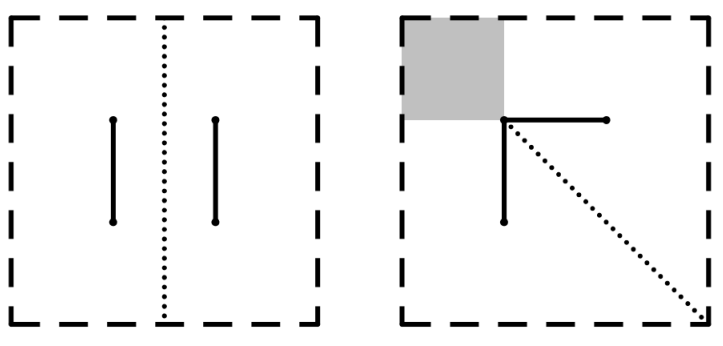

# The Grand Tournament

Time limit: $4$ seconds. Memory limit: $1024$ MB. Standard input and standard output.

The First Grand Tournament of Automated Driving has begun!

The experimental field is an axis-aligned rectangle in the plane, with bottom-left corner $(x_l,y_l)$ and top-right corner $(x_r,y_r)$. Two line segments $A$ and $B$ lie strictly inside the rectangle. They may have points in common. A car inside the rectangle is treated as a point.

In this subtask, the car must remain at equal distances from the two segments throughout its movement. The distance from a point $P$ to a segment $Q$ is the minimum Euclidean distance from $P$ to any point of $Q$.

The figure illustrates the sample data. Find the area of all valid positions of the car inside the rectangle.

## Input

The first line contains the number of test cases $T$ ($1\leq T\leq10^5$).

For each test case, the first line contains four integers $x_l,y_l,x_r,y_r$ ($-1000\leq x_l<x_r\leq1000$, $-1000\leq y_l<y_r\leq1000$), specifying the rectangle.

Each of the next two lines contains four integers $x_1,y_1,x_2,y_2$, specifying one segment with endpoints $(x_1,y_1)$ and $(x_2,y_2)$. They satisfy $x_1,x_2\in(x_l,x_r)$ and $y_1,y_2\in(y_l,y_r)$.

The two endpoints of each individual segment are distinct.

## Output

For each test case, output one real number: the area of valid positions. The absolute or relative error must not exceed $10^{-9}$.

Formally, if your answer is $a$ and the jury's answer is $b$, the answer is accepted if and only if

$$
\frac{|a-b|}{\max\{1,|b|\}}\leq10^{-9}.
$$
