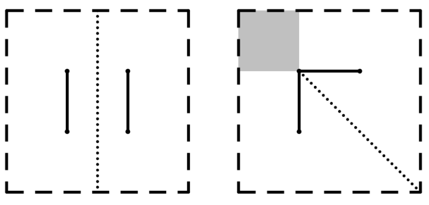

# The Grand Tournament

时间限制：$4$ 秒。内存限制：$1024$ MB。使用标准输入和标准输出。

首届自动驾驶大奖赛正式开始了！

比赛场地是平面上一个各边平行于坐标轴的矩形，左下角为 $(x_l,y_l)$，右上角为 $(x_r,y_r)$。矩形内部严格放置了两条线段 $A$ 和 $B$，它们可以有公共点。场地中还有一辆汽车，将它视为一个点。

比赛的这个子任务要求：汽车在移动过程中，到这两条线段的距离必须始终相等。点 $P$ 到线段 $Q$ 的距离，定义为 $P$ 到 $Q$ 上任意点的欧几里得距离的最小值。

上图是样例数据的示意图。请编写程序，求汽车在矩形中所有合法位置组成区域的面积。

## 输入

第一行包含测试用例数 $T$（$1\leq T\leq10^5$）。

每个测试用例的第一行包含四个整数 $x_l,y_l,x_r,y_r$（$-1000\leq x_l<x_r\leq1000$、$-1000\leq y_l<y_r\leq1000$），表示矩形的位置。

接下来两行，每行包含四个整数 $x_1,y_1,x_2,y_2$，表示端点为 $(x_1,y_1)$ 和 $(x_2,y_2)$ 的一条线段，满足 $x_1,x_2\in(x_l,x_r)$ 且 $y_1,y_2\in(y_l,y_r)$。

保证每条线段自身的两个端点不重合。

## 输出

对于每个测试用例，输出一个实数，表示合法位置区域的面积。绝对误差或相对误差不超过 $10^{-9}$ 的答案将被接受。

准确地说，设你的答案为 $a$，标准答案为 $b$，当且仅当满足以下条件时接受答案：

$$
\frac{|a-b|}{\max\{1,|b|\}}\leq10^{-9}.
$$
