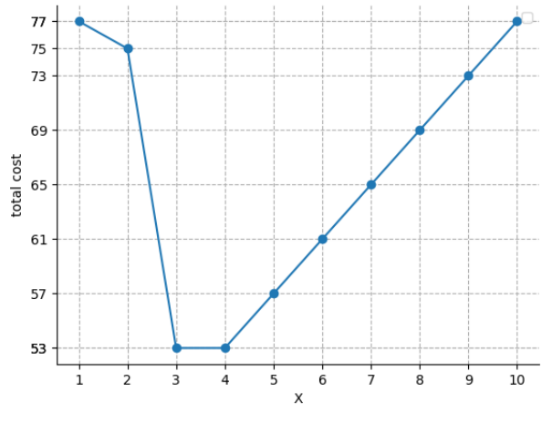

# Knights of the Frozen Throne

Time limit: $2$ seconds. Memory limit: $1024$ MB. Standard input and standard output.

Knights of the Frozen Throne is a popular online game developed by ICPC Entertainment, Inc.

A single server, the Zeus Super Computer (ZSC), handles every player's requests. Initially the design keeps all player data in memory so requests can be answered without database queries. This design becomes difficult to scale as the game grows more popular.

Engineer Tom proposes using a very large database to reduce costs. After studying the players' behavior, he can accurately predict when each player will send requests. He now wants to implement time-based caching.

A player's data stays in memory only temporarily. When a request arrives:

- If that player's data is absent, ZSC loads it into memory and records the last request time.
- If the data is already in memory, ZSC answers immediately and updates the last request time.

ZSC removes the data when $X$ seconds have elapsed since that player's last request, where $X$ is a positive integer to be chosen. In particular, a request arriving exactly $X$ seconds after the previous request requires the data to be loaded again. The memory is initially empty.

Choose a positive integer $X$ minimizing the total cost. Keeping one player's data in memory for one second costs $a$ dollars. If the data of $i$ players is loaded during the same second, the total CPU cost for those loads is $i\cdot b_i$.

## Input

The first line contains $m$ ($1\leq m\leq10^5$), the number of players.

Each of the next $m$ lines describes one player's requests. It starts with $k$ ($1\leq k\leq5\times10^5$), followed by $k$ integers $p_1,p_2,\ldots,p_k$ ($1\leq p_1\leq p_2\leq\cdots\leq p_k\leq10^9$), the request times in seconds. The total number of requests over all players does not exceed $5\times10^5$.

The next line contains $a$ ($1\leq a\leq10^4$), the memory cost for one player for one second.

The last line contains $m$ integers $b_1,b_2,\ldots,b_m$ ($1\leq b_i\leq10^9$). If $i$ players' data is loaded during one second, each player's load costs $b_i$.

## Output

On the first line, print two integers: the minimum total cost and the number of positive integers $X$ attaining it. On the second line, print all such $X$ in increasing order.

It can be proved that only finitely many positive integers $X$ attain the minimum.

## Note

The figure shows the total cost for different $X$ in the first example.

