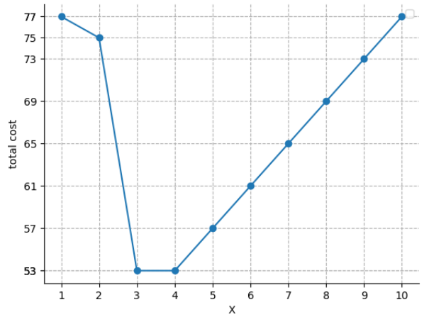

# Knights of the Frozen Throne

时间限制：$2$ 秒。内存限制：$1024$ MB。使用标准输入和标准输出。

《冰封王座的骑士》是由 ICPC 娱乐公司开发并发行的一款热门网络游戏。

一台名为宙斯超级计算机（ZSC）的服务器处理所有玩家的请求。原来的设计将所有玩家的数据都存放在内存中，从而无需查询数据库就能响应请求。但随着游戏越来越受欢迎，这种设计很难继续扩展。

工程师 Tom 希望使用一个容量很大的数据库来节省成本。经过研究，他掌握了玩家的行为规律，可以准确预测每个玩家何时会发送请求。现在，他准备部署一种按时间淘汰的缓存方案。

每个玩家的数据只在内存中保留一段时间。收到请求时：

- 如果该玩家的数据不在内存中，ZSC 会将其载入内存，并记录该玩家最近一次请求的时间。
- 如果数据已经在内存中，ZSC 会立即响应请求，然后更新该玩家最近一次请求的时间。

自某个玩家上次请求起经过 $X$ 秒后，ZSC 就会将其数据移出内存，其中 $X$ 是待确定的正整数。特别地，如果请求恰好在上次请求的 $X$ 秒后到达，就必须重新载入数据。内存最初为空。

请选出使总成本最小的正整数 $X$。将一位玩家的数据在内存中保留一秒，费用为 $a$ 美元。如果同一秒内载入了 $i$ 位玩家的数据，这些载入操作的 CPU 总费用为 $i\cdot b_i$。

## 输入

第一行包含整数 $m$（$1\leq m\leq10^5$），表示玩家数。

接下来 $m$ 行，每行描述一位玩家的请求：先给出整数 $k$（$1\leq k\leq5\times10^5$），再给出 $k$ 个整数 $p_1,p_2,\ldots,p_k$（$1\leq p_1\leq p_2\leq\cdots\leq p_k\leq10^9$），表示请求发生的时刻，单位为秒。保证所有玩家的请求总数不超过 $5\times10^5$。

下一行包含整数 $a$（$1\leq a\leq10^4$），表示将一位玩家的数据保留在内存中一秒的费用。

最后一行包含 $m$ 个整数 $b_1,b_2,\ldots,b_m$（$1\leq b_i\leq10^9$）。若同一秒载入 $i$ 位玩家的数据，则其中每位玩家的数据载入费用为 $b_i$。

## 输出

第一行输出两个整数：最小总成本，以及能达到该成本的正整数 $X$ 的个数。第二行按递增顺序输出所有这样的 $X$。

可以证明，使总成本达到最小的正整数 $X$ 只有有限多个。

## 说明

下图展示了第一组样例在不同 $X$ 下的总成本。

