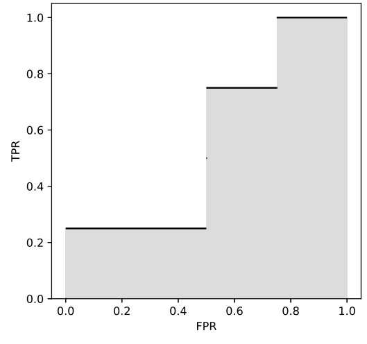

# Scholomance Academy

Time limit: $4$ seconds. Memory limit: $1024$ MB. Standard input and standard output.

As a student of Scholomance Academy, you are taking Machine Learning and working on a course project: training a binary classifier.

A binary classifier predicts whether an instance is positive (`+`) or negative (`-`). A typical classifier has a scoring function $S$ and a threshold $\theta$. If an instance $x$ satisfies $S(x)\geq\theta$, it is classified as positive; otherwise it is classified as negative. Different thresholds can give different classifiers.

Misclassifying a positive instance as negative is a false negative. Misclassifying a negative instance as positive is a false positive. The possible outcomes are:

| Actual class | Predicted positive | Predicted negative |
| --- | --- | --- |
| Positive | True positive ($\mathrm{TP}$) | False negative ($\mathrm{FN}$) |
| Negative | False positive ($\mathrm{FP}$) | True negative ($\mathrm{TN}$) |

For a given dataset and classifier, the true positive rate and false positive rate are

$$
\mathrm{TPR}=\frac{\#\mathrm{TP}}{\#\mathrm{TP}+\#\mathrm{FN}},\qquad
\mathrm{FPR}=\frac{\#\mathrm{FP}}{\#\mathrm{TN}+\#\mathrm{FP}}.
$$

Here $\#\mathrm{TP}$ counts true positives; $\#\mathrm{FP}$, $\#\mathrm{TN}$, and $\#\mathrm{FN}$ are defined similarly.

Your scoring function is trained, and you want to evaluate the classifier. Let $\mathrm{TPR}(\theta)$ and $\mathrm{FPR}(\theta)$ be the rates at threshold $\theta$. Define the area under curve as

$$
\mathrm{AUC}=\int_0^1\max_{\theta\in\mathbb{R}}\{\mathrm{TPR}(\theta)\mid\mathrm{FPR}(\theta)\leq r\}\,dr.
$$

The integrand, called the receiver operating characteristic (ROC), is the maximum attainable $\mathrm{TPR}$ under the constraint $\mathrm{FPR}\leq r$.

Given the actual classes and predicted scores in the dataset, compute the classifier's AUC.

For the third example, threshold $\theta=30$ gives $3$ true positives, $2$ false positives, $2$ true negatives, and $1$ false negative. Thus $\mathrm{TPR}(30)=0.75$ and $\mathrm{FPR}(30)=0.5$. Varying the threshold gives the ROC curve and AUC illustrated below.

## Input

The first line contains $n$ ($2\leq n\leq10^6$), the number of instances. Each of the next $n$ lines contains a character $c\in\{+,-\}$ and an integer $s$ ($1\leq s\leq10^9$), the actual class and predicted score of an instance.

There is at least one instance of each class.

## Output

Output the AUC with an absolute error no greater than $10^{-9}$.
