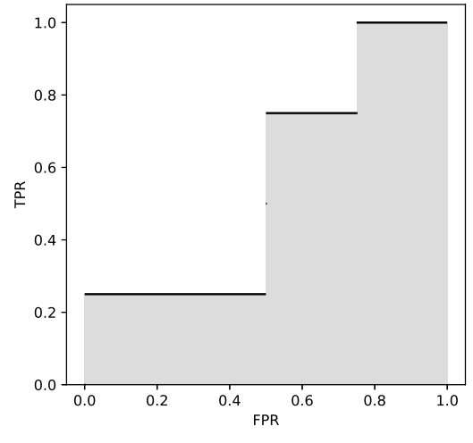

# Scholomance Academy

时间限制：$4$ 秒。内存限制：$1024$ MB。使用标准输入和标准输出。

作为通灵学院的学生，你正在学习机器学习，并完成课程项目：训练一个二分类器。

二分类器预测一个样本属于正类（`+`）还是负类（`-`）。典型的二分类器包含评分函数 $S$ 和阈值 $\theta$。如果样本 $x$ 满足 $S(x)\geq\theta$，就将其预测为正类；否则预测为负类。选择不同的阈值，可能得到不同的分类器。

将正类样本误判为负类，称为假阴性；将负类样本误判为正类，称为假阳性。各情况如下：

| 实际类别 | 预测为正类 | 预测为负类 |
| --- | --- | --- |
| 正类 | 真阳性（$\mathrm{TP}$） | 假阴性（$\mathrm{FN}$） |
| 负类 | 假阳性（$\mathrm{FP}$） | 真阴性（$\mathrm{TN}$） |

对于给定数据集和分类器，定义真正例率和假正例率为

$$
\mathrm{TPR}=\frac{\#\mathrm{TP}}{\#\mathrm{TP}+\#\mathrm{FN}},\qquad
\mathrm{FPR}=\frac{\#\mathrm{FP}}{\#\mathrm{TN}+\#\mathrm{FP}}.
$$

其中，$\#\mathrm{TP}$ 表示真阳性样本数，$\#\mathrm{FP}$、$\#\mathrm{TN}$、$\#\mathrm{FN}$ 的含义类似。

现在你已经训练好了评分函数，希望评估分类器的表现。设 $\mathrm{TPR}(\theta)$ 和 $\mathrm{FPR}(\theta)$ 表示阈值为 $\theta$ 时的两个比率。定义曲线下面积为

$$
\mathrm{AUC}=\int_0^1\max_{\theta\in\mathbb{R}}\{\mathrm{TPR}(\theta)\mid\mathrm{FPR}(\theta)\leq r\}\,dr.
$$

被积函数称为受试者工作特征（ROC），表示在 $\mathrm{FPR}\leq r$ 的限制下能够达到的最大 $\mathrm{TPR}$。

给定数据集中各样本的实际类别和预测分数，请计算分类器的 AUC。

例如，第三组样例取阈值 $\theta=30$ 时，有 $3$ 个真阳性、$2$ 个假阳性、$2$ 个真阴性和 $1$ 个假阴性，因此 $\mathrm{TPR}(30)=0.75$、$\mathrm{FPR}(30)=0.5$。不断改变阈值，就能得到下图所示的 ROC 曲线及 AUC。

## 输入

第一行包含整数 $n$（$2\leq n\leq10^6$），表示样本数。接下来 $n$ 行，每行包含一个字符 $c\in\{+,-\}$ 和一个整数 $s$（$1\leq s\leq10^9$），表示一个样本的实际类别及预测分数。

保证正类和负类都至少有一个样本。

## 输出

输出分类器的 AUC，要求绝对误差不超过 $10^{-9}$。
