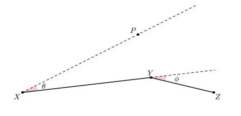

# Paddle Star

Time limit: $1$ second. Memory limit: $1024$ MiB. Standard input and standard output.

Putata has recently become fascinated with playing Zoe. He is practicing her ability, Paddle Star.

Zoe fires a star and can redirect it during flight. The damage increases with the flying distance. Suppose she is at point $X$ and fires in any direction. If she redirects the star at point $Y$ toward point $Z$, its path is $X\to Y\to Z$. If the star meets an enemy anywhere on its path, it disappears immediately and damages that enemy.

Putata is not skilled enough to control the ability freely. The first segment $XY$ always has length $\ell_1$, and the second segment $YZ$ always has length $\ell_2$. Zoe faces a fixed direction $\overrightarrow{XP}$. Let the directed angle from $\overrightarrow{XP}$ to $\overrightarrow{XY}$ be $\theta$ degrees, and the directed angle from $\overrightarrow{XY}$ to $\overrightarrow{YZ}$ be $\varphi$ degrees. They satisfy $\theta\in[-\alpha,\alpha]$ and $\varphi\in[-\beta,\beta]$.

Putata's rival Budada wants to know the total area that could possibly be attacked by Putata's Zoe. Budada is busy with mathematics, so help him find it.

## Input

The first line contains the number of test cases $T$ ($1\leq T\leq 10^5$).

Each test case consists of one line containing four integers $\ell_1,\ell_2,\alpha,\beta$ ($1\leq\ell_2\leq\ell_1\leq 10^9$, $0\leq\alpha\leq90$, $0\leq\beta<180$), describing the ability.

## Output

For each test case, output one real number: the total area. The absolute or relative error must not exceed $10^{-6}$.

Formally, if your answer is $a$ and the jury's answer is $b$, it is accepted when

$$
\frac{|a-b|}{\max(1,|b|)}\leq10^{-6}.
$$
