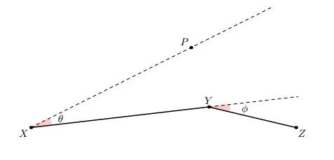

# Paddle Star

时间限制：$1$ 秒。内存限制：$1024$ MiB。使用标准输入和标准输出。

Putata 最近迷上了使用佐伊，现在正在练习她的技能“飞星乱入”。

佐伊可以发射一颗星星，并在飞行过程中改变它的方向。星星飞行的距离越长，造成的伤害就越大。假设佐伊位于点 $X$，先向任意方向发射星星，再在星星到达点 $Y$ 时将其转向点 $Z$，那么星星的轨迹就是 $X\to Y\to Z$。星星在轨迹上的任意位置遇到敌人时，都会立即消失并对该敌人造成伤害。

Putata 还不能熟练地控制这个技能，因此他发出的星星总是满足以下限制：第一段 $XY$ 的长度固定为 $\ell_1$，第二段 $YZ$ 的长度固定为 $\ell_2$。佐伊面向固定方向 $\overrightarrow{XP}$。从 $\overrightarrow{XP}$ 到 $\overrightarrow{XY}$ 的有向角为 $\theta$ 度，从 $\overrightarrow{XY}$ 到 $\overrightarrow{YZ}$ 的有向角为 $\varphi$ 度，并且 $\theta\in[-\alpha,\alpha]$、$\varphi\in[-\beta,\beta]$。

Putata 的对手 Budada 想知道，Putata 操作的佐伊有可能攻击到的区域总面积是多少。Budada 正忙于研究数学问题，请你帮他求出答案。

## 输入

第一行包含测试用例数 $T$（$1\leq T\leq 10^5$）。

每个测试用例占一行，包含描述该技能的四个整数 $\ell_1,\ell_2,\alpha,\beta$（$1\leq\ell_2\leq\ell_1\leq 10^9$、$0\leq\alpha\leq90$、$0\leq\beta<180$）。

## 输出

对于每个测试用例，输出一个实数，表示可攻击区域的总面积。绝对误差或相对误差不超过 $10^{-6}$ 的答案将被接受。

准确地说，设你的答案为 $a$，标准答案为 $b$，满足以下条件时接受答案：

$$
\frac{|a-b|}{\max(1,|b|)}\leq10^{-6}.
$$
