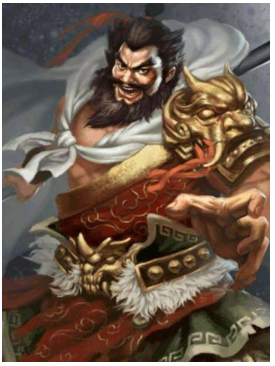

# Zhang Fei Threading Needles - Thick with Fine

Time limit: $1$ second. Memory limit: $512$ MB. Standard input and standard output.

The saying “Zhang Fei threading needles — thick with fine” means that a person who appears careless can also be meticulous. We should not judge people only by appearances: they may have abilities that others do not know.

Zhang Fei is often described as rude and reckless. His roar at the Changban Bridge in Dangyang frightened away Cao Cao's million-strong army. General Xia Houjie was so frightened that his liver and gallbladder shattered and he fell from his horse. Even the river beneath the bridge flowed backwards. The scene was astonishing and has been remembered for generations.

In his military career, whether capturing Liu Dai and Shi Yanyan, or fighting at the Changban Bridge and defeating Zhang He at Eight Mongs, he repeatedly achieved remarkable victories and became famous throughout the armies. Thus people say “Zhang Fei threading needles — thick with fine”.

How many of Cao Cao's troops were frightened away by Zhang Fei's roar at the Changban Bridge?

Explanation: Xia Houjie fell from his horse after being frightened to death, so he remained at the scene and is not counted among those frightened away.

## Input

The input is one integer $N$ ($1\leq N\leq1000000$), the number of Cao Cao's troops in front of the Changban Bridge.

## Output

Output one integer: the number of troops frightened away by Zhang Fei's roar.
