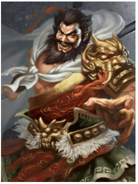

# 张飞穿针——粗中有细

时间限制：$1$ 秒。内存限制：$512$ MB。使用标准输入和标准输出。

“张飞穿针——粗中有细”是说，像张飞这样表面粗犷、看似不拘小节的人，也有细致缜密的一面。这告诉我们看人不能只看表面，每个人都可能有旁人尚不了解的本领。

说到张飞，人们往往想到“粗鲁莽撞”。他在当阳长坂桥上一声怒吼，吓退了曹操的百万大军；夏侯杰更是被吓得肝胆俱裂、倒撞下马，连桥下的河水仿佛都为之倒流。那一幕惊心动魄，历经千年仍令人难忘。

在张飞的戎马生涯中，从擒刘岱、释严颜，到威震长坂桥、八濛山战张郃，他屡立奇功，名扬三军，让人刮目相看。因此民间有了“张飞穿针——粗中有细”的说法。

那么，你知道当年张飞在长坂桥上一声怒吼，究竟吓跑了多少曹军吗？

说明：夏侯杰被吓得肝胆俱裂、倒撞下马，留在了原地，因此不计入被吓跑的人数。

## 输入

输入一个整数 $N$（$1\leq N\leq1000000$），表示长坂桥前曹军的人数。

## 输出

输出一个整数，表示被张飞一声怒吼吓跑的曹军人数。
