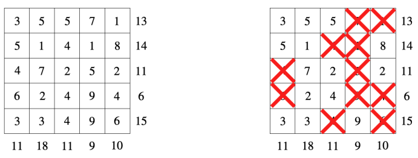
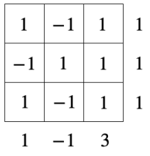
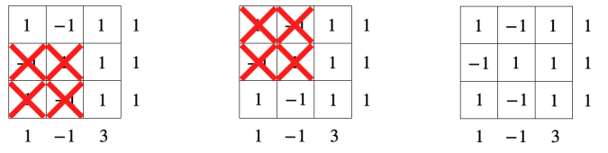

# (-1,1)-Sumplete

Time limit: $3$ seconds. Memory limit: $1024$ MB. Standard input and standard output.

Sumplete is a logic puzzle similar to Sudoku, Kakuro, and Hitori, known for being developed with the help of ChatGPT [1].

A Sumplete puzzle is a square grid of integers, with an integer hint for every row and column. Cross out some entries so that the sum of the remaining entries in every row and column equals its hint.

The figure shows a $5\times5$ puzzle on the left and a solution on the right.

On $2023$-$9$-$15$, Suthee Ruangwises uploaded the paper `Sumplete is Hard, Even with Two Different Numbers` to arXiv [2]. It proves that, if rectangular grids are allowed, deciding whether a Sumplete puzzle is solvable is NP-complete even when the grid uses only $1$ and $3$.

Bobo is dissatisfied: surely some Sumplete puzzles must be easy to solve. He gives you a square puzzle whose entries are only $-1$ and $1$. Solve it for him.

## Input

The first line contains $n$ ($1\leq n\leq4000$), the height and width of the grid.

Each of the next $n$ lines contains a string $s_i$ of length $n$, consisting of `+` and `-`. Entry $a_{i,j}=1$ when the $j$-th character of $s_i$ is `+`, and $a_{i,j}=-1$ when it is `-`.

The next line contains $n$ integers $r_1,r_2,\ldots,r_n$ ($-n\leq r_i\leq n$), the row hints.

The final line contains $n$ integers $c_1,c_2,\ldots,c_n$ ($-n\leq c_i\leq n$), the column hints.

## Output

If there is no solution, print `No` on the first line. Otherwise, print `Yes`. Letter case does not matter: for example, `yEs`, `yes`, `Yes`, and `YES` are all accepted affirmative answers.

After an affirmative answer, output $n$ binary strings of length $n$. In string $t_i$, the $j$-th character `0` means to cross out entry $(i,j)$, and `1` means to keep it. Every row and column sum of the kept entries must equal its hint. Any valid solution is accepted.

## Note

The first sample is the following $3\times3$ puzzle:

Its three solutions are shown below. The third keeps every entry. Any of them is accepted.

## References

[1] About the puzzle's creation: https://sumplete.com/about/

[2] The paper: https://arxiv.org/pdf/2309.07161.pdf
