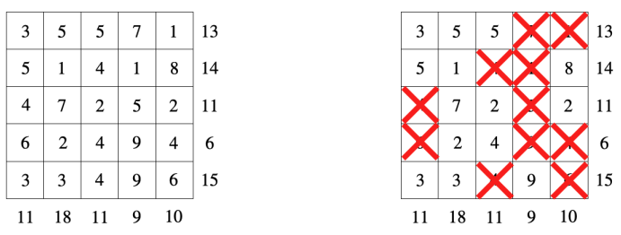
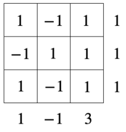
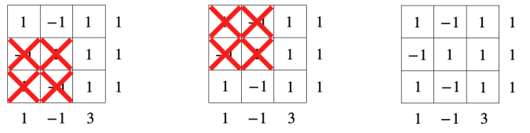

# (-1,1)-Sumplete

时间限制：$3$ 秒。内存限制：$1024$ MB。使用标准输入和标准输出。

Sumplete 是一种类似数独、Kakuro 和 Hitori 的逻辑谜题，因借助 ChatGPT 开发而闻名 [1]。

Sumplete 谜题由一个整数方阵组成，每行和每列都有一个整数提示数。玩家需要划掉部分格子，使每行、每列剩余格子中的数字之和都等于对应的提示数。

上图左侧是一个 $5\times5$ 的谜题，右侧是它的一种解。

$2023$ 年 $9$ 月 $15$ 日，Suthee Ruangwises 在 arXiv 上发布了论文 `Sumplete is Hard, Even with Two Different Numbers` [2]。论文证明：如果允许使用矩形网格，那么即使格子中只有 $1$ 和 $3$ 两种数字，判断一个 Sumplete 谜题是否有解仍是 NP 完全问题。

Bobo 对这个结果并不满意：总该有一些容易解决的 Sumplete 谜题。他现在给你一个方阵谜题，格子里只有 $-1$ 和 $1$ 两种数字，请你帮他求解。

## 输入

第一行包含整数 $n$（$1\leq n\leq4000$），表示方阵的行数和列数。

接下来 $n$ 行，每行包含一个长度为 $n$、由 `+` 和 `-` 组成的字符串 $s_i$。若 $s_i$ 的第 $j$ 个字符为 `+`，则 $a_{i,j}=1$；若为 `-`，则 $a_{i,j}=-1$。

下一行包含 $n$ 个整数 $r_1,r_2,\ldots,r_n$（$-n\leq r_i\leq n$），表示各行的提示数。

最后一行包含 $n$ 个整数 $c_1,c_2,\ldots,c_n$（$-n\leq c_i\leq n$），表示各列的提示数。

## 输出

如果谜题无解，第一行输出 `No`；否则输出 `Yes`。字母大小写不限，例如 `yEs`、`yes`、`Yes`、`YES` 都会被视为肯定回答。

如果回答有解，接下来输出 $n$ 个长度为 $n$ 的二进制串。字符串 $t_i$ 的第 $j$ 个字符为 `0`，表示划掉格子 $(i,j)$；为 `1`，表示保留该格子。保留格子中的数字，必须使每行、每列的和都等于对应提示数。若有多个解，输出任意一个即可。

## 说明

第一组样例对应以下 $3\times3$ 谜题：

它的三种解如下所示，其中第三种解没有划掉任何数字。输出其中任意一种都能被接受。

## 参考资料

[1] 关于这个谜题的开发经过：https://sumplete.com/about/

[2] 论文链接：https://arxiv.org/pdf/2309.07161.pdf
