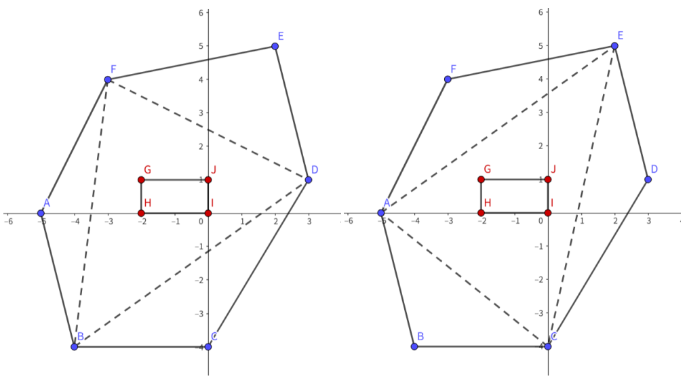

# Inside Triangle

Time limit: $3$ seconds. Memory limit: $1024$ MB. Standard input and standard output.

A polygon $P_1$ contains polygon $P_2$ if every point inside or on $P_2$ is also inside or on $P_1$. It strictly contains $P_2$ if every point inside or on $P_2$ is strictly inside $P_1$, with none on the boundary.

Panda has two convex polygons $P$ and $Q$, with $n$ and $m$ vertices respectively. Polygon $Q$ is strictly contained in $P$.

Count the ways to choose exactly $3$ distinct vertices of $P$ that form a triangle $P_\Delta$ containing $Q$. This containment need not be strict.

## Input

The first line contains the number of test cases $T$ ($1\leq T\leq1000$).

For each test case, the first line contains $n$ ($3\leq n\leq3\cdot10^5$), the number of vertices of $P$.

The next $n$ lines each contain two integers $x,y$ ($|x|,|y|\leq10^9$), a vertex of $P$. Vertices are listed in counterclockwise order, and no three vertices of this polygon are collinear.

The next line contains $m$ ($3\leq m\leq3\cdot10^5$), the number of vertices of $Q$.

The next $m$ lines each contain two integers $x,y$ ($|x|,|y|\leq10^9$), a vertex of $Q$. Vertices are listed in counterclockwise order, no three vertices of this polygon are collinear, and $Q$ is strictly contained in $P$.

Over all test cases, both $\sum n$ and $\sum m$ do not exceed $5\cdot10^5$.

## Output

For each test case, output the number of valid triangles as one integer on its own line.

## Note

In the first example, polygon $P$ is `ABCDEF` and polygon $Q$ is `GHIJ`. The valid triangles are $\triangle ACE$ and $\triangle BDF$.
