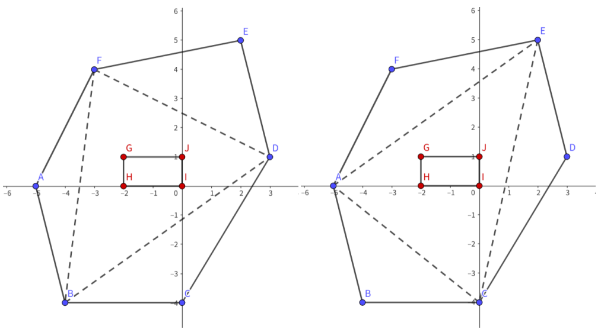

# Inside Triangle

时间限制：$3$ 秒。内存限制：$1024$ MB。使用标准输入和标准输出。

如果多边形 $P_2$ 内部和边界上的每个点，都位于多边形 $P_1$ 的内部或边界上，则称 $P_1$ 包含 $P_2$。如果多边形 $P_2$ 内部和边界上的每个点，都严格位于 $P_1$ 内部、没有任何点位于其边界上，则称 $P_1$ 严格包含 $P_2$。

Panda 有两个凸多边形 $P$ 和 $Q$，它们分别有 $n$ 和 $m$ 个顶点。保证 $Q$ 被 $P$ 严格包含。

请统计从 $P$ 中恰好选择 $3$ 个不同顶点的方案数，使这些顶点组成的三角形 $P_\Delta$ 包含 $Q$。这里不要求严格包含，允许 $Q$ 的点位于三角形边界上。

## 输入

第一行包含测试用例数 $T$（$1\leq T\leq1000$）。

每个测试用例的第一行包含整数 $n$（$3\leq n\leq3\cdot10^5$），表示 $P$ 的顶点数。

接下来 $n$ 行，每行包含两个整数 $x,y$（$|x|,|y|\leq10^9$），表示 $P$ 的一个顶点。顶点按逆时针顺序给出，保证该多边形的任意三个顶点不共线。

下一行包含整数 $m$（$3\leq m\leq3\cdot10^5$），表示 $Q$ 的顶点数。

接下来 $m$ 行，每行包含两个整数 $x,y$（$|x|,|y|\leq10^9$），表示 $Q$ 的一个顶点。顶点按逆时针顺序给出，保证该多边形的任意三个顶点不共线，并且 $Q$ 被 $P$ 严格包含。

保证所有测试用例的 $\sum n$ 和 $\sum m$ 都分别不超过 $5\cdot10^5$。

## 输出

对于每个测试用例，在单独一行中输出一个整数，表示满足条件的三角形数量。

## 说明

第一组样例中，多边形 $P$ 为 `ABCDEF`，多边形 $Q$ 为 `GHIJ`。满足条件的三角形是 $\triangle ACE$ 和 $\triangle BDF$。
