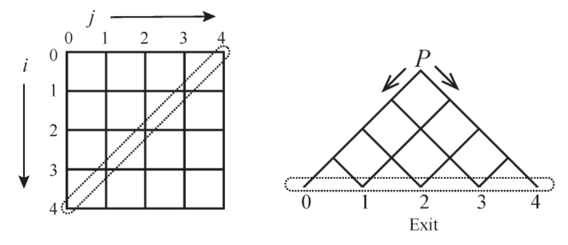

# Pyramid

Time limit: 3 seconds. Memory limit: 1024 megabytes.

## Problem Description

Consider an $n\times n$ grid whose nodes are labelled $(i,j)$ for $0\le i,j<n$. Rotate it $45^\circ$ clockwise and keep only its top half. This gives a pyramid, as shown in Figure 1. The nodes on the anti-diagonal have labels $(n-1-j,j)$ for $0\le j<n$ and lie on the bottom line of the pyramid. For simplicity, call node $(n-1-j,j)$ exit $j$. Node $(0,0)$ is the starting point, labelled $P$ in Figure 1.

When a ball is inserted at the starting point, it rolls down to an exit. From node $(i,j)$, it can move only to $(i+1,j)$ or $(i,j+1)$; it never breaks or splits. Every node other than an exit has a working switch with exactly two states, $L$ and $R$. These states send the ball to $(i+1,j)$ and $(i,j+1)$, respectively. Immediately after the ball leaves, the switch changes to the other state. Every switch is initially in state $L$.



Figure 1: An example with $n=5$.

The first ball inserted at $P$ reaches exit 0, leaving every switch at $(i,0)$ for $0\le i<n-1$ in state $R$. Insert the second, third, and subsequent balls one at a time until the $k$-th ball finishes. Switch states persist between balls. Determine the exit number reached by the $k$-th ball.

## Input Format

The first line contains the number of test cases. Each test case consists of one line with two space-separated numbers $n$ and $k$.

## Output Format

For each test case, output the exit number of the $k$-th ball on one line.

## Technical Specification

- There are at most 20 test cases.
- $1\le n\le10^4$.
- $1\le k\le10^8$.

## Sample 1

### Input

```text
2
5 1
5 2
```

### Output

```text
0
1
```

## Sample 2

### Input

```text
3
5 3
5 4
5 5
```

### Output

```text
2
3
2
```
