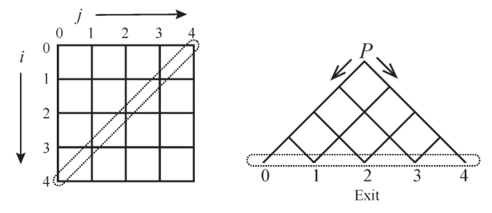

# 金字塔

时间限制：3 秒。内存限制：1024 兆字节。

## 题目描述

有一个 $n\times n$ 的网格，节点编号为 $(i,j)$，其中 $0\le i,j<n$。将它顺时针旋转 $45^\circ$，只保留上半部分，就得到图 1 所示的金字塔。原网格反对角线上的节点编号为 $(n-1-j,j)$，其中 $0\le j<n$；这些节点位于金字塔的底边上。为方便描述，将节点 $(n-1-j,j)$ 称为出口 $j$。节点 $(0,0)$ 是起点，在图 1 中标为 $P$。

从起点放入一个球后，它会向下滚到某个出口。位于节点 $(i,j)$ 的球只能滚向 $(i+1,j)$ 或 $(i,j+1)$，球不会破裂或分裂。除出口外，每个节点都有一个正常工作的开关。开关只有 $L$ 和 $R$ 两种状态，分别使球滚向 $(i+1,j)$ 和 $(i,j+1)$。球离开节点后，开关立刻切换到另一种状态。所有开关最初均为 $L$ 状态。



图 1：$n=5$ 时的例子。

从 $P$ 放入的第一个球会到达出口 0，此时所有满足 $0\le i<n-1$ 的节点 $(i,0)$ 上的开关都变为 $R$。随后依次放入第二个、第三个球，直到第 $k$ 个球滚出。每个开关的状态会保留下来，供后续的球使用。请确定第 $k$ 个球到达的出口编号。

## 输入格式

第一行给出测试用例数。每个测试用例只有一行，包含两个以空格分隔的数 $n$ 和 $k$。

## 输出格式

对于每个测试用例，输出一行，表示第 $k$ 个球到达的出口编号。

## 数据范围

- 测试用例不超过 20 组。
- $1\le n\le10^4$。
- $1\le k\le10^8$。

## 样例 1

### 输入

```text
2
5 1
5 2
```

### 输出

```text
0
1
```

## 样例 2

### 输入

```text
3
5 3
5 4
5 5
```

### 输出

```text
2
3
2
```
