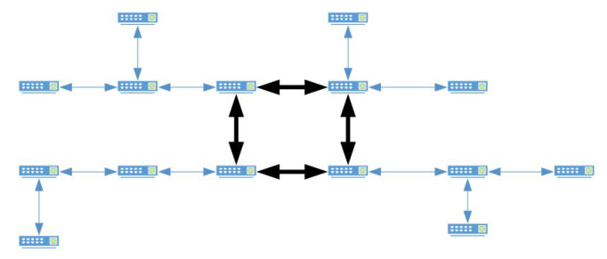
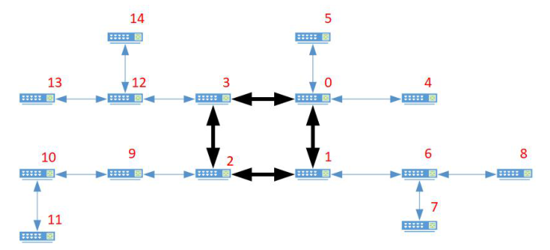
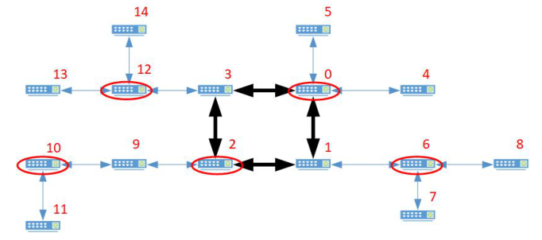

# Cable Protection

Time limit: 2 seconds. Memory limit: 1024 megabytes.

## Problem Description

ICPC (International Cable Protection Company) produces a cable protection tool. Installed on a network switch, it monitors whether all cable links connected to that switch work properly. Since the tool causes transmission delay, installing it on every switch is undesirable.

A typical network consists of a backbone and several subnets. The backbone switches form a ring. Each backbone switch is the root of a subnet whose switches form a tree. This is a unicyclic topology; Figure 2 gives an example.



Figure 2: An example of a unicyclic topology.

There are $n$ backbone switches and $m$ subnet switches, numbered from $0$ to $n+m-1$. The backbone switches are numbered from $0$ to $n-1$ in clockwise order. The subnet switches are numbered from $n$ to $n+m-1$. In each rooted subnet tree, a subnet switch has a larger number than its parent. Figure 3 shows an example of the numbering.



Figure 3: An example of switch numbering.

Find the minimum number of switches on which protection tools must be installed so that every cable link is monitored. Figure 4 shows an optimal selection for the example network; the selected switches are circled by ellipses.



Figure 4: An optimal solution for the example network.

## Input Format

The first line contains two space-separated integers $n$ and $m$, the numbers of backbone switches and subnet switches. Each of the following $n+m$ lines contains two space-separated integers giving the numbers of the two switches at the ends of a cable link.

## Output Format

Output the minimum number of switches selected for installing protection tools that monitor all cable links.

## Technical Specification

- $3\le n\le100000$.
- $1\le m\le100000$.

## Sample 1

### Input

```text
3 2
0 1
1 2
0 2
1 3
2 4
```

### Output

```text
2
```

## Sample 2

### Input

```text
4 11
0 1
0 3
0 4
0 5
1 2
1 6
2 3
2 9
3 12
6 7
6 8
9 10
10 11
12 13
12 14
```

### Output

```text
5
```
