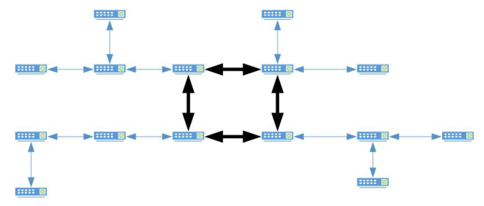
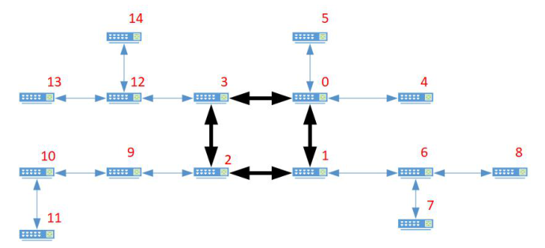
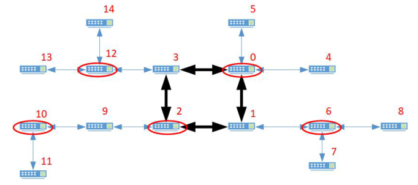

# 线缆保护

时间限制：2 秒。内存限制：1024 兆字节。

## 题目描述

ICPC（International Cable Protection Company，国际线缆保护公司）生产了一种线缆保护装置。将它安装到网络交换机上后，它能够监控与该交换机相连的所有线缆是否正常工作。由于这种装置会引入传输延迟，因此不宜在每台交换机上都安装。

通常，一个网络由骨干网和若干子网构成。骨干网中的交换机连接成一个环，每台骨干交换机又是一个子网的根，该子网中的交换机连接成一棵树。这种拓扑称为单环拓扑，图 2 给出了一个例子。



图 2：一个单环拓扑的例子。

设有 $n$ 台骨干交换机和 $m$ 台子网交换机，总编号为 $0$ 到 $n+m-1$。骨干交换机按顺时针顺序编号为 $0$ 到 $n-1$，子网交换机编号为 $n$ 到 $n+m-1$。在每棵有根子网树中，子网交换机的编号都大于其父节点的编号。图 3 展示了交换机编号的一个例子。



图 3：交换机编号的一个例子。

请帮助 ICPC 确定：为了监控所有线缆，最少需要在多少台交换机上安装保护装置。图 4 给出了示例网络的一个最优方案，椭圆圈出的交换机就是选中的交换机。



图 4：示例网络的一个最优方案。

## 输入格式

第一行包含两个以空格分隔的整数 $n$ 和 $m$，分别表示骨干交换机和子网交换机的数量。接下来的 $n+m$ 行，每行包含两个以空格分隔的整数，表示一条线缆两端的交换机编号。

## 输出格式

输出一个整数，表示为了监控所有线缆，最少需要选择多少台交换机安装保护装置。

## 数据范围

- $3\le n\le100000$。
- $1\le m\le100000$。

## 样例 1

### 输入

```text
3 2
0 1
1 2
0 2
1 3
2 4
```

### 输出

```text
2
```

## 样例 2

### 输入

```text
4 11
0 1
0 3
0 4
0 5
1 2
1 6
2 3
2 9
3 12
6 7
6 8
9 10
10 11
12 13
12 14
```

### 输出

```text
5
```
