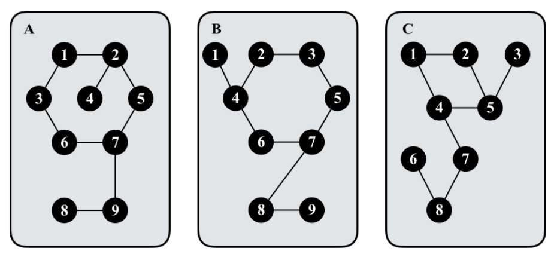

# Graph Cards

Time limit: 4 seconds. Memory limit: 1024 megabytes.

## Problem Description

A deck of graph cards is placed on a table. Each card $\chi$ has an undirected simple graph $G_\chi$. The graph is connected and has the same number of vertices and edges. Different cards may have different numbers of vertices. An example is shown below.



Two cards are identical if and only if their graphs, $G_1=(V_1,E_1)$ and $G_2=(V_2,E_2)$, are isomorphic. This means there is a bijection $f$ between $V_1$ and $V_2$ such that, for every $x,y\in V_1$, $(x,y)\in E_1$ if and only if $(f(x),f(y))\in E_2$. Compute the number of distinct graph cards in the deck.

## Input Format

The first line contains an integer $t$, the number of test cases. Each test case describes a deck. Its first line contains the number of cards $n>0$. The next $n$ lines each describe the graph $G$ on one card, in the following format:

$$k\ u_1\ v_1\ u_2\ v_2\ \cdots\ u_k\ v_k$$

Here $k>0$ is the number of vertices and also the number of edges in $G$. For every $i\in[1,k]$, the pair $(u_i,v_i)$ is an edge joining vertices $u_i$ and $v_i$. Vertex identifiers are integers in $[1,k]$.

## Output Format

For each test case, output the number of distinct graph cards in the deck on one line.

## Technical Specification

- $0<t\le3$.
- $0<n,k\le10^6$.
- In each test case, the sum of the numbers of vertices over all $n$ cards is at most $10^6$.

## Sample 1

### Input

```text
1
2
4 1 2 2 3 3 1 1 4
4 1 2 2 3 3 1 2 4
```

### Output

```text
1
```

## Sample 2

### Input

```text
2
2
4 1 2 2 3 3 1 1 4
5 1 2 2 3 3 1 2 4 2 5
3
9 1 2 2 5 5 7 7 6 6 3 3 1 2 4 7 9 9 8
9 1 4 4 2 2 3 3 5 5 7 7 6 6 4 7 8 8 9
9 1 2 2 5 5 4 4 1 4 7 7 8 8 6 8 9 5 3
```

### Output

```text
2
2
```
