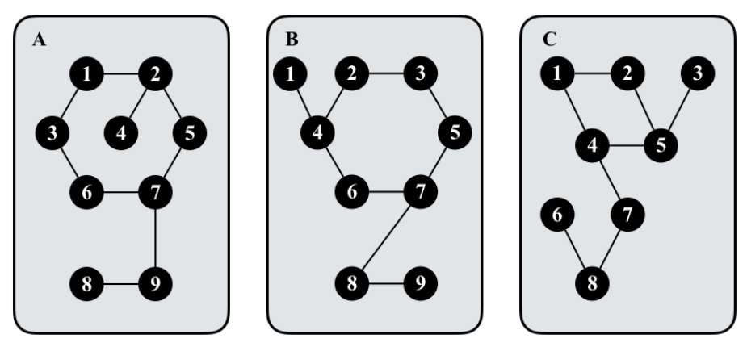

# 图卡片

时间限制：4 秒。内存限制：1024 兆字节。

## 题目描述

桌上放着一叠图卡片。每张卡片 $\chi$ 上都有一张无向简单图 $G_\chi$，这张图连通，且顶点数与边数相同。不同卡片的顶点数可以不同。下图给出了一个例子。



两张卡片相同，当且仅当它们对应的图 $G_1=(V_1,E_1)$ 和 $G_2=(V_2,E_2)$ 同构。也就是说，$V_1$ 与 $V_2$ 之间存在一个双射 $f$，对于任意 $x,y\in V_1$，都有：$(x,y)\in E_1$ 当且仅当 $(f(x),f(y))\in E_2$。请计算这叠卡片中不同图卡片的数量。

## 输入格式

第一行包含一个整数 $t$，表示测试用例数。每个测试用例描述一叠卡片：第一行给出卡片数 $n>0$，接下来的 $n$ 行，每行描述一张卡片上的图 $G$，格式如下：

$$k\ u_1\ v_1\ u_2\ v_2\ \cdots\ u_k\ v_k$$

其中，$k>0$ 表示图 $G$ 的顶点数，同时也是边数。对于每个 $i\in[1,k]$，$(u_i,v_i)$ 表示连接顶点 $u_i$ 和 $v_i$ 的一条边。顶点编号为 $[1,k]$ 内的整数。

## 输出格式

对于每个测试用例，输出一行，表示这叠卡片中不同图卡片的数量。

## 数据范围

- $0<t\le3$。
- $0<n,k\le10^6$。
- 每个测试用例中，所有 $n$ 张卡片的顶点数之和不超过 $10^6$。

## 样例 1

### 输入

```text
1
2
4 1 2 2 3 3 1 1 4
4 1 2 2 3 3 1 2 4
```

### 输出

```text
1
```

## 样例 2

### 输入

```text
2
2
4 1 2 2 3 3 1 1 4
5 1 2 2 3 3 1 2 4 2 5
3
9 1 2 2 5 5 7 7 6 6 3 3 1 2 4 7 9 9 8
9 1 4 4 2 2 3 3 5 5 7 7 6 6 4 7 8 8 9
9 1 2 2 5 5 4 4 1 4 7 7 8 8 6 8 9 5 3
```

### 输出

```text
2
2
```
