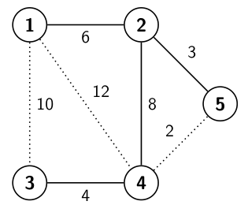

# Optimization for UltraNet

Time limit: 3 seconds. Memory limit: 1024 megabytes.

## Problem Description

UltraNet connects every city in a country. Cities $i$ and $j$ are directly connected when a cable of symmetric bandwidth $b_{i,j}=b_{j,i}$ joins them. Cities without a direct cable still have at least one path between them. The current network may provide more than one path between a pair of cities.

The network works well, but maintaining cables is expensive. Energy consumption, which is proportional to a cable's bandwidth, is another concern. UltraNet therefore wants to reorganize the network according to the following priorities, in order:

1. Minimize the number of cables while keeping the whole network connected. In other words, there must be exactly one path between every pair of cities.
2. Among the choices meeting the first priority, maximize the bottleneck of the whole network. The network bottleneck is the smallest bandwidth of any city pair. The bandwidth $b'_{i,j}$ of a pair $(i,j)$ is the smallest cable bandwidth on the unique path from $i$ to $j$.
3. Among choices meeting both previous priorities, minimize total energy consumption: the sum of the bandwidths of the remaining cables.

Optimize the network and output the sum of the bandwidths over all pairs of cities in the optimized network. In the example below, discard the three dotted cables. The resulting bottleneck is 3, the sum of remaining cable bandwidths is $6+3+8+4=21$, and the sum over all pairs of cities is

$$\sum_{i=1}^{n-1}\sum_{j=i+1}^{n}b'_{i,j}=6+4+6+3+4+8+3+4+3+3=44.$$



## Input Format

Each test case starts with two integers $n$ and $m$, the numbers of cities and cables. The following $m$ lines describe the cables. Each contains three positive integers $i$, $j$, and $b_{i,j}$, meaning that a cable of bandwidth $b_{i,j}$ directly joins cities $i$ and $j$. Cities are numbered from $1$ to $n$, and $i<j$ because $b_{i,j}=b_{j,i}$.

There is at most one cable between any pair of cities. All cable bandwidths are distinct: no two cables have the same bandwidth.

## Output Format

Output one integer: the sum of the bandwidths over all pairs of cities in the optimized network.

## Technical Specification

- $2\le n\le10000$.
- $1\le m\le500000$.
- $1\le i<j\le n$.
- $0<b_{i,j}<10^7$.

## Sample 1

### Input

```text
3 3
1 2 5
1 3 6
2 3 8
```

### Output

```text
20
```

## Sample 2

### Input

```text
5 7
1 2 6
1 3 10
1 4 12
2 4 8
2 5 3
3 4 4
4 5 2
```

### Output

```text
44
```

## Sample 3

### Input

```text
5 5
2 5 1
1 2 2
2 3 4
1 3 5
2 4 6
```

### Output

```text
24
```
