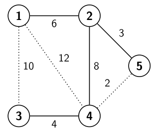

# UltraNet 网络优化

时间限制：3 秒。内存限制：1024 兆字节。

## 题目描述

UltraNet 为一个国家的所有城市提供网络连接。如果城市 $i$ 与 $j$ 之间铺设了一条带宽为 $b_{i,j}=b_{j,i}$ 的双向线缆，就称这两个城市直接相连。没有直接线缆相连的两个城市之间也至少存在一条路径。在当前网络中，某些城市对之间可能存在多条路径。

虽然当前网络运转良好，但维护每条线缆的费用很高。节能也是一个需要考虑的问题：一条线缆的能耗与其带宽成正比。因此，UltraNet 希望按以下先后顺序优化网络：

1. 在保持整个网络连通的前提下，使线缆数量最少。也就是说，任意两个城市之间都应恰好只有一条路径。
2. 在满足第一项的方案中，使整个网络的瓶颈带宽最大。整个网络的瓶颈带宽是所有城市对带宽中的最小值。城市对 $(i,j)$ 的带宽记为 $b'_{i,j}$，等于从 $i$ 到 $j$ 的唯一路径上线缆带宽的最小值。
3. 在同时满足前两项的方案中，使网络总能耗最小，也就是使保留下来的所有线缆的带宽之和最小。

请帮助 UltraNet 优化网络，并输出优化后所有城市对的带宽之和。在下图的例子中，需要移除三条虚线线缆。最终网络的瓶颈带宽为 3，保留线缆的带宽之和为 $6+3+8+4=21$，所有城市对的带宽之和为

$$\sum_{i=1}^{n-1}\sum_{j=i+1}^{n}b'_{i,j}=6+4+6+3+4+8+3+4+3+3=44.$$



## 输入格式

每个测试用例以两个整数 $n$ 和 $m$ 开始，分别表示城市数和线缆数。接下来的 $m$ 行描述各条线缆。每行包含三个正整数 $i$、$j$ 和 $b_{i,j}$，表示城市 $i$ 与 $j$ 之间直接连接了一条带宽为 $b_{i,j}$ 的线缆。城市编号为 $1$ 到 $n$，并且由于 $b_{i,j}=b_{j,i}$，输入保证 $i<j$。

任意两个城市之间至多有一条线缆。所有线缆的带宽两两不同，即不存在两条带宽相同的线缆。

## 输出格式

输出一个整数，表示优化后网络中所有城市对的带宽之和。

## 数据范围

- $2\le n\le10000$。
- $1\le m\le500000$。
- $1\le i<j\le n$。
- $0<b_{i,j}<10^7$。

## 样例 1

### 输入

```text
3 3
1 2 5
1 3 6
2 3 8
```

### 输出

```text
20
```

## 样例 2

### 输入

```text
5 7
1 2 6
1 3 10
1 4 12
2 4 8
2 5 3
3 4 4
4 5 2
```

### 输出

```text
44
```

## 样例 3

### 输入

```text
5 5
2 5 1
1 2 2
2 3 4
1 3 5
2 4 6
```

### 输出

```text
24
```
