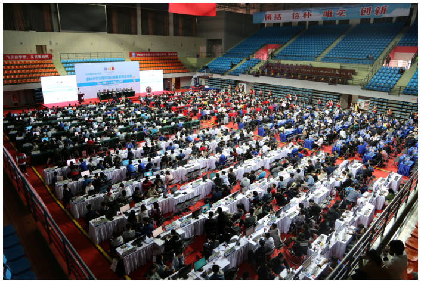

# Ah, It's Yesterday Once More

## Description

In 2018, hosted by Nanjing University of Aeronautics and Astronautics (NUAA), the International Collegiate Programming Contest (ICPC) regional was held in Nanjing again after a few years' gap. There were over 400 teams in the contest, and team Power of Two from Tsinghua University won the champion.

Two years have passed after the great success in 2018 and 2019. NUAA continues to hold the ICPC Nanjing Regional in 2020. Although we cannot gather in Nanjing this time due to the pandemic, we should still be grateful for the hard work done by all staff and volunteers for this contest. Thank you all for your great contribution to this contest!



The 2018 ICPC Asia Nanjing Regional Contest.

In the 2018 contest, problem K, Kangaroo Puzzle, requires the contestants to construct an operation sequence for the game. Let us first recall the content of that problem:

The puzzle is a grid with $n$ rows and $m$ columns ($1\le n,m\le20$), containing at least $2$ kangaroos. The player must control them to get together. Some cells contain walls and cannot be entered; all other cells are empty. A kangaroo can move to an adjacent empty cell in one of four directions: up, down, left and right. Every empty cell is reachable from every other empty cell through adjacent empty cells. There is no cycle: a kangaroo cannot start at an empty cell, pass through several distinct empty cells, and return to its starting cell.

Initially, exactly one kangaroo stands in every empty cell. Pressing U, D, L or R moves all kangaroos simultaneously in the corresponding direction. For example, R moves a kangaroo one cell to the right if that cell exists and is empty; otherwise it stays where it is.

The contestant must construct a sequence of at most $5\times10^4$ operations consisting only of U, D, L and R. If after executing the sequence there are still two kangaroos in different cells, the verdict is Wrong Answer.

Our dear friend Kotori also participated and submitted the following randomized solution. To her surprise, it was accepted:

```cpp
#include <bits/stdc++.h>
using namespace std;
string s = "UDLR";
int main() {
    srand(time(NULL));
    for (int i = 1; i <= 50000; i++) putchar(s[rand() % 4]);
    return 0;
}
```

For those unfamiliar with C and C++, this code outputs a random string of length $5\times10^4$, consisting only of U, D, L and R. Every character is equally likely to appear at every position.

Kotori suspects the problem is not that simple. In this 2020 ICPC Nanjing Regional contest, construct an input to hack her solution. Because of the randomness, your input only needs to achieve a successful hacking rate of at least $25\%$.

Formally, we have prepared $500$ random strings, with every character equally likely at every position, and use each as a controlling sequence on your map. Your answer is accepted only if in at least $125$ trials there are still kangaroos in different cells after executing the entire sequence.

Your map must also satisfy every validity requirement:

- Its size is at most $20\times20$.
- It has at least $2$ empty cells.
- Every empty cell is reachable from every other empty cell.
- The empty cells contain no cycle.

## Input

There is no input for this problem. You are on your own!

## Output

First output two integers $n$ and $m$ ($1\le n,m\le20$), separated by a space, denoting the numbers of rows and columns of your map.

Then output $n$ lines. Line $i$ is a binary string $s_{i,1}s_{i,2}\cdots s_{i,m}$ of length $m$, where $s_{i,j}\in\{0,1\}$. If $s_{i,j}=1$, the cell in row $i$, column $j$ is empty; otherwise it is a wall and cannot be entered.

You only need a successful hacking rate of at least $25\%$. Not that hard, is it?

## Note

The sample output is (obviously) incorrect and only illustrates the output format. It is a $3\times4$ map with $4$ walls, so initially there are $8$ kangaroos in its empty cells.

### Sample 1

#### Input

```text

```

#### Output

```text
3 4
1111
1010
1100
```
