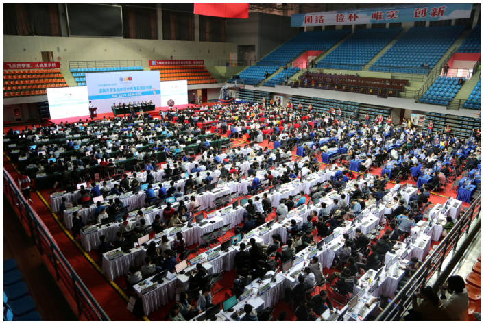

# Ah, It's Yesterday Once More

## 题目描述

2018 年，由南京航空航天大学（NUAA）承办的国际大学生程序设计竞赛（ICPC）区域赛时隔数年再次在南京举行。超过 400 支队伍参加了比赛，清华大学的 Power of Two 队获得冠军。

继 2018 年和 2019 年比赛取得成功后，两年过去了，南京航空航天大学在 2020 年继续承办 ICPC 南京区域赛。虽然这次由于疫情无法相聚南京，我们仍应感谢所有工作人员和志愿者的辛勤付出。感谢大家为本次比赛作出的贡献！



2018 ICPC 亚洲区域赛南京站。

2018 年比赛的 K 题 Kangaroo Puzzle 要求选手为一个游戏构造操作序列。先回顾一下那道题的内容：

棋盘是一个 $n$ 行 $m$ 列的网格（$1\le n,m\le20$），其中至少有 $2$ 只袋鼠。玩家的目标是控制它们聚到一起。有些格子是不能进入的墙，其余格子为空格。袋鼠可以向上、下、左、右四个方向移动到相邻空格。保证任意空格都能通过相邻空格到达其他任意空格，且不存在环：袋鼠不可能从一个空格出发，经过若干互不相同的其他空格，再回到原来的格子。

初始时，每个空格中恰好有一只袋鼠。按下 U、D、L 或 R，会使所有袋鼠同时向对应方向移动。例如，按下 R 时，如果右侧格子存在且为空格，袋鼠就向右移动一格；否则留在原地。

选手需要构造一个仅由 U、D、L、R 组成、长度不超过 $5\times10^4$ 的操作序列。若执行完整个序列后，仍有两只袋鼠处于不同格子中，则判为 Wrong Answer。

我们的朋友 Kotori 也参加了比赛，并提交了下面这个随机算法。令她意外的是，这份程序通过了评测：

```cpp
#include <bits/stdc++.h>
using namespace std;
string s = "UDLR";
int main() {
    srand(time(NULL));
    for (int i = 1; i <= 50000; i++) putchar(s[rand() % 4]);
    return 0;
}
```

如果你不熟悉 C 或 C++：上面的程序会输出一个长度为 $5\times10^4$、仅由 U、D、L、R 组成的随机字符串，每个位置出现四种字符的概率相等。

Kotori 怀疑这道题没这么简单。因此，在这场 2020 ICPC 南京区域赛中，你需要构造一组输入来使她的程序出错。由于程序具有随机性，只要求你的输入使其出错的概率至少为 $25\%$。

具体来说，我们预先生成了 $500$ 个随机字符串，每个位置上的四种字符等概率出现，并依次将它们作为控制序列用于你输出的地图。至少要有 $125$ 次试验在完整执行控制序列后，仍有袋鼠位于不同格子中，你的答案才会被接受。

你输出的地图还必须满足以下全部合法性要求：

- 地图大小不超过 $20\times20$。
- 至少有 $2$ 个空格。
- 任意空格都能到达其他任意空格。
- 空格之间不能形成环。

## 输入格式

本题没有输入。请自行构造答案！

## 输出格式

第一行输出两个用空格分隔的整数 $n$ 和 $m$（$1\le n,m\le20$），表示地图的行数和列数。

接下来输出 $n$ 行，第 $i$ 行是一个长度为 $m$ 的二进制字符串 $s_{i,1}s_{i,2}\cdots s_{i,m}$，其中 $s_{i,j}\in\{0,1\}$。若 $s_{i,j}=1$，则第 $i$ 行、第 $j$ 列为空格；否则该格子为不能进入的墙。

只需要使程序出错的概率至少达到 $25\%$。应该不难吧？

## 说明

给出的样例输出（显然）不是正确答案，仅用于展示输出格式。这是一张 $3\times4$ 的地图，有 $4$ 个墙格，因此初始时有 $8$ 只袋鼠分别位于空格中。

### 样例 1

#### 输入

```text

```

#### 输出

```text
3 4
1111
1010
1100
```
