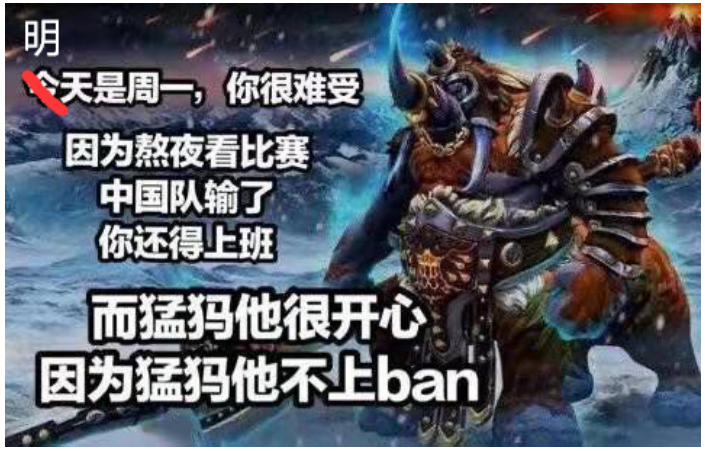

# A Hero Named Magnus

## Description

Dota 2 is a multiplayer online battle arena (MOBA) game developed and published by Valve. In each match, two teams of five players occupy and defend separate bases. Each of the ten players independently controls a hero with unique abilities and a different play style. Players collect experience and items to defeat opposing heroes in combat. The first team to destroy the other team's Ancient, a large structure in its base, wins.

The International is the annual Dota 2 world championship hosted and produced by Valve. There are 18 participating teams: 12 qualify through the Dota Pro Circuit final results, and six more qualify by winning regional playoffs in North America, South America, Southeast Asia, China, Eastern Europe and Western Europe.

In 3021, The International is held in Guilin, China. Just as 1000 years before, Team LGD from China faces Team Spirit from Russia. As the championship has developed, the final is now best of $n$ games, where $n$ is a positive odd integer. A team needs at least $\frac{n+1}{2}$ wins to become champion. In 2021, $n=5$ and Team Spirit won $3:2$.

Before a game starts, teams may ban certain heroes so that the opposing team cannot use them. For these 1000 years, everyone has known that Team Spirit excels at the hero Magnus, who helped it defeat Team LGD in 2021.



Although everyone expects LGD to ban Magnus from the beginning, LGD thinks it is strong enough to defeat the opponent's Magnus and will only start banning Magnus in the $x$-th game, if that game takes place.

To simplify the problem, LGD certainly wins a game if it bans Magnus. Otherwise it has a $50\%$ chance of winning that game.

As an LGD fan, JB wants the minimum total number of games $n$ that guarantees LGD the championship even in the worst case.

## Input

The first line contains an integer $T$ ($1\le T\le10^5$), the number of test cases.

Each of the next $T$ lines contains an integer $x$ ($1\le x\le2\times10^9$), meaning LGD starts banning Magnus in the $x$-th game.

## Output

For each test case, output one integer on a line: the minimum total number of games that lets LGD win the championship in the worst case.

## Note

Despite everyone's strongest wishes, test data with $x>1$ do exist: LGD does not always ban Magnus from the beginning.

### Sample 1

#### Input

```text
2
1
3
```

#### Output

```text
1
5
```
