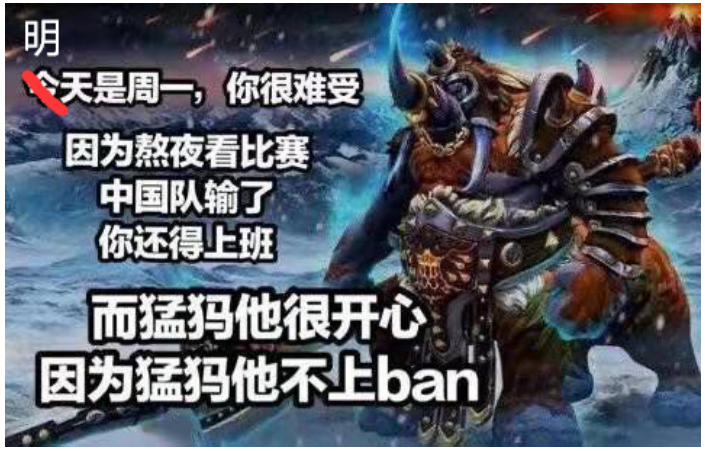

# A Hero Named Magnus

## 题目描述

Dota 2 是由 Valve 开发并发行的一款多人在线战术竞技（MOBA）游戏。每场比赛由两支各有五名选手的队伍参与，分别占据并保卫自己的基地。十名选手各自独立控制一名英雄，每名英雄都有独特技能和玩法。选手通过获得经验和物品，在对战中击败对方英雄。率先摧毁对方基地中大型建筑“远古遗迹”的队伍获胜。

The International 是由 Valve 主办的年度 Dota 2 世界锦标赛，共有 18 支参赛队伍：其中 12 支根据 Dota Pro Circuit 的最终成绩获得资格，另外六支来自北美、南美、东南亚、中国、东欧和西欧赛区的预选赛冠军。

3021 年，The International 在中国桂林举行。和 1000 年前一样，中国的 LGD 队再次与俄罗斯的 Spirit 队交锋。随着赛事发展，如今决赛采用最多进行 $n$ 局的赛制，其中 $n$ 为正奇数；一支队伍至少赢下 $\frac{n+1}{2}$ 局即可夺冠。2021 年时，$n=5$，Spirit 队以 $3:2$ 获胜。

每局开始前，队伍可以禁用特定英雄，使对手无法使用。在这 1000 年里，所有人都知道 Spirit 队非常擅长使用英雄 Magnus（猛犸），正是这个英雄帮助他们在 2021 年击败了 LGD 队。



虽然大家都希望 LGD 从一开始就禁用猛犸，但 LGD 认为自己足以击败对手的猛犸，因此只会从第 $x$ 局开始禁用猛犸，前提是比赛能进行到这一局。

为简化问题，若 LGD 在某局禁用猛犸，就一定能赢下该局；否则，该局获胜的概率为 $50\%$。

作为 LGD 的粉丝，JB 想知道总局数 $n$ 最少为多少，才能保证 LGD 即使在最坏的情况下也能夺冠。

## 输入格式

第一行包含一个整数 $T$（$1\le T\le10^5$），表示测试用例数。

接下来 $T$ 行，每行包含一个整数 $x$（$1\le x\le2\times10^9$），表示 LGD 从第 $x$ 局开始禁用猛犸。

## 输出格式

对于每个测试用例，输出一行一个整数，表示能保证 LGD 在最坏情况下夺冠的最小总局数。

## 说明

尽管大家强烈希望如此，测试数据中仍然存在 $x>1$ 的情况，也就是说 LGD 并不总是从第一局就禁用猛犸。

### 样例 1

#### 输入

```text
2
1
3
```

#### 输出

```text
1
5
```
