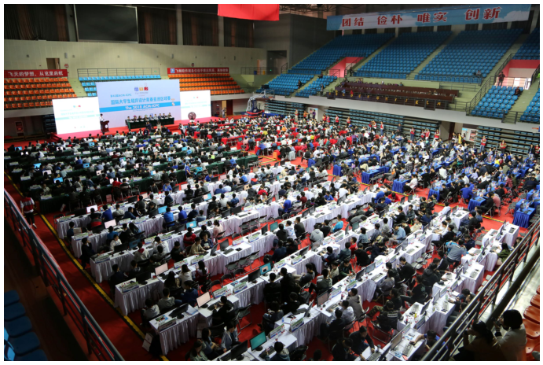

# Oops, It's Yesterday Twice More

## Description

After the great success in 2018, 2019 and 2020, Nanjing University of Aeronautics and Astronautics (NUAA) hosts the International Collegiate Programming Contest (ICPC) Nanjing regional for the fourth time.

Team Power of Two and team Three Hold Two from Tsinghua University won in 2018 and 2019. In 2020, team Inverted Cross from Peking University won. In 2021, about 700 teams, including the defending champion, participate. We are excited to see who wins this year!

Although we cannot gather in Nanjing this time due to the pandemic, we should still be grateful for all staff and volunteers' hard work. Thank you for your great contribution to the contest!



The 2018 ICPC Asia Nanjing Regional Contest.

In the 2018 contest, problem K, Kangaroo Puzzle, asked contestants to construct an operation sequence for the following game:

The puzzle is a grid with $n$ rows and $m$ columns ($1\le n,m\le20$), containing at least $2$ kangaroos. The player must make them gather. Some cells are walls that cannot be entered; all others are empty. A kangaroo can move to an adjacent empty cell in one of four directions: up, down, left and right.

Initially, exactly one kangaroo stands in each empty cell. Press U, D, L or R to move all kangaroos simultaneously in that direction.

Contestants must construct a sequence of at most $5\times10^4$ operations using only U, D, L and R to reach the goal.

In the 2020 contest, problem A, Ah, It's Yesterday Once More, asked contestants to construct an input map that hacks the following code for the previous problem:

```cpp
#include <bits/stdc++.h>
using namespace std;
string s = "UDLR";
int main() {
    srand(time(NULL));
    for (int i = 1; i <= 50000; i++) putchar(s[rand() % 4]);
    return 0;
}
```

Now, in the 2021 contest, Paimon prepares another version. You are given an $n\times n$ grid ($2\le n\le500$). Every cell is empty, and each cell initially contains one kangaroo.

As before, U, D, L and R move all kangaroos simultaneously. For a kangaroo in row $i$, column $j$, denoted by $(i,j)$:

1. U: move to $(i-1,j)$ if $i>1$; otherwise stay.
2. D: move to $(i+1,j)$ if $i<n$; otherwise stay.
3. L: move to $(i,j-1)$ if $j>1$; otherwise stay.
4. R: move to $(i,j+1)$ if $j<n$; otherwise stay.

Construct a string consisting only of U, D, L and R, of length at most $3(n-1)$, so that after applying it every kangaroo gathers at the target cell $(a,b)$.

## Input

There is exactly one test case in each input file.

The only line contains three integers $n,a,b$ ($2\le n\le500$, $1\le a,b\le n$), giving the grid size and target cell.

## Output

Output one line containing a string consisting only of U, D, L and R, of length at most $3(n-1)$. It can be proved that an answer always exists.

### Sample 1

#### Input

```text
3 3 3
```

#### Output

```text
RRDD
```

### Sample 2

#### Input

```text
4 3 2
```

#### Output

```text
DLDLDLUR
```
