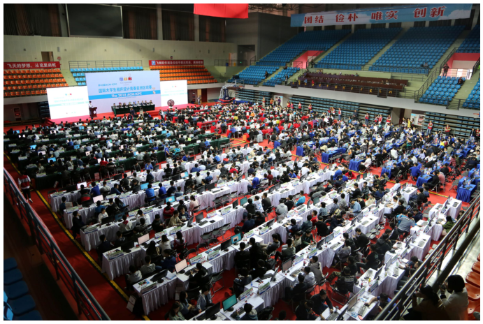

# Oops, It's Yesterday Twice More

## 题目描述

继 2018 年、2019 年和 2020 年比赛取得成功后，南京航空航天大学（NUAA）第四次承办国际大学生程序设计竞赛（ICPC）南京区域赛。

清华大学的 Power of Two 队和 Three Hold Two 队分别在 2018 年与 2019 年获得冠军；2020 年的冠军则是北京大学的 Inverted Cross 队。2021 年，约有 700 支队伍参赛，其中包括卫冕冠军。我们非常期待今年的冠军归属！

虽然这次由于疫情无法相聚南京，我们仍应感谢所有工作人员和志愿者的辛勤工作。感谢大家为本次比赛作出的贡献！



2018 ICPC 亚洲区域赛南京站。

2018 年比赛的 K 题 Kangaroo Puzzle 要求选手为下面的游戏构造操作序列：

棋盘是一个 $n$ 行 $m$ 列的网格（$1\le n,m\le20$），其中至少有 $2$ 只袋鼠。玩家需要让它们聚到一起。一些格子为不能进入的墙，其余格子为空格。袋鼠可以向上、下、左、右四个方向移动到相邻空格。

初始时，每个空格中恰好有一只袋鼠。按下 U、D、L 或 R，所有袋鼠就会同时向对应方向移动。

选手需要构造一个仅由 U、D、L、R 组成、长度不超过 $5\times10^4$ 的操作序列来达成目标。

2020 年比赛的 A 题 Ah, It's Yesterday Once More 则要求选手构造一张输入地图，使下面这个解决上述问题的程序出错：

```cpp
#include <bits/stdc++.h>
using namespace std;
string s = "UDLR";
int main() {
    srand(time(NULL));
    for (int i = 1; i <= 50000; i++) putchar(s[rand() % 4]);
    return 0;
}
```

现在，在 2021 年的比赛中，Paimon 为你准备了另一个版本：给定一个 $n\times n$ 的网格（$2\le n\le500$），所有格子都是空格，初始时每个格子中恰好有一只袋鼠。

和之前一样，U、D、L、R 会同时控制所有袋鼠移动。对于位于第 $i$ 行、第 $j$ 列，即 $(i,j)$ 的袋鼠：

1. U：若 $i>1$，则移动到 $(i-1,j)$；否则留在原地。
2. D：若 $i<n$，则移动到 $(i+1,j)$；否则留在原地。
3. L：若 $j>1$，则移动到 $(i,j-1)$；否则留在原地。
4. R：若 $j<n$，则移动到 $(i,j+1)$；否则留在原地。

请构造一个仅由 U、D、L、R 组成、长度不超过 $3(n-1)$ 的字符串，使执行完操作后所有袋鼠都聚集在目标格子 $(a,b)$。

## 输入格式

每个输入文件只有一组测试数据。

唯一一行包含三个整数 $n,a,b$（$2\le n\le500$，$1\le a,b\le n$），表示网格大小和目标格子。

## 输出格式

输出一行，仅包含 U、D、L、R 组成的字符串，长度不能超过 $3(n-1)$。可以证明答案一定存在。

### 样例 1

#### 输入

```text
3 3 3
```

#### 输出

```text
RRDD
```

### 样例 2

#### 输入

```text
4 3 2
```

#### 输出

```text
DLDLDLUR
```
