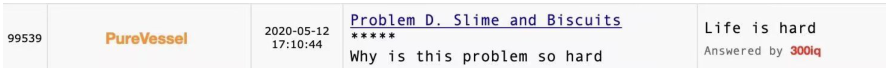
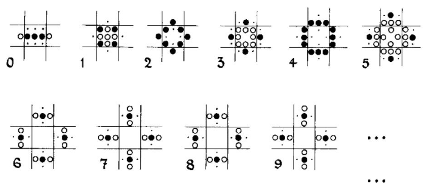
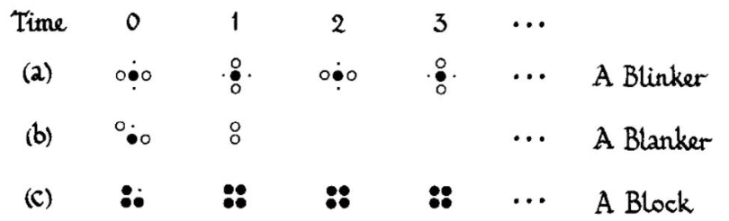
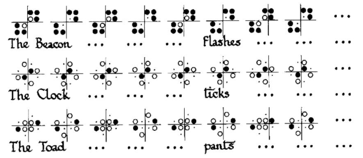
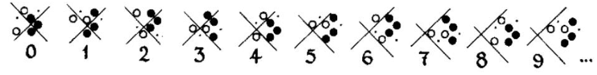

# Life is Hard and Undecidable, but...

## Description

To John Horton Conway, his Game of Life, and also the life we are living...

**Disclaimer:** If you have no patience for the full context or already know Game of Life, the actual task is in the last paragraph on the third page of the original PDF.

Life is hard. There are beautiful dreams you can never realize. There are regrets and lost loved ones, yet you cannot turn back time. There is death ahead, with the anxiety it persistently gives you, yet you cannot escape it. There are problems right here for you to solve, yet you simply do not know how.



Life is hard.

Life is undecidable. You never know what you are going to get from this box of chocolates. Having experienced all the Black Swan and Grey Rhino events over the years, we all wonder what happens next and what the future will be like. “C'est la vie”, say the old folks. It goes to show you never can tell.

But life goes on. We have wines to drink, songs to sing, problems to solve, and games to play. Our game now is Game of Life, or simply Life, devised by the famous British mathematician John Horton Conway in 1970.

Life is a zero-player game on an infinite square grid. Every cell is either alive or dead. You choose which cells are alive in generation $0$; after that, the state of each generation is completely determined by the previous generation using these rules:

- **Birth:** a cell dead at generation $t$ becomes alive at generation $t+1$ if and only if exactly $3$ of its $8$ neighbors were alive at generation $t$.
- **Death by overcrowding:** a cell alive at generation $t$ becomes dead at generation $t+1$ if at least $4$ of its $8$ neighbors were alive at generation $t$.
- **Death by exposure:** a cell alive at generation $t$ becomes dead at generation $t+1$ if at most $1$ of its $8$ neighbors was alive at generation $t$.
- **Survival:** a cell alive at generation $t$ remains alive at generation $t+1$ if $2$ or $3$ of its $8$ neighbors were alive at generation $t$.

The rules can be remembered as “Just $3$ for birth, $2$ or $3$ for survival.”

The following example starts with only five live cells in a line and eventually becomes a traffic-light pattern repeating with period $2$. Filled circles denote live cells that remain alive in the next generation; unfilled circles denote live cells that die in the next generation; dots denote dead cells that become alive in the next generation. All the following pictures are from Winning Ways for Your Mathematical Plays, Volume $4$, by Elwyn R. Berlekamp and John H. Conway.



A line of five becomes traffic lights.

Here are other starting configurations with different destinies:



Different starts, different destinies.

Some starting configurations enter a repeating life cycle:



Three life cycles with period $2$.

Another example is a moving glider:



A glider moving diagonally.

Mathematicians and theoretical computer scientists are fascinated by Life. They ask: given a starting configuration, can we determine whether it will eventually die out, that is, whether there is some finite generation $t$ with no live cells? This problem is not only NP-hard but even undecidable. A pattern in Life can act as a finite-state machine connected to two counters. Such a machine has the same computational power as a universal Turing machine. Thus Life is theoretically as powerful as a computer with unlimited memory and time: it is Turing complete. Several programmable computer architectures have been implemented in Life, including a pattern that simulates Tetris.

Although this suggests that we can never unravel every mystery of Life, there are still things we can do. Construction is one of them, and is exactly what this task asks for:

Given a positive integer $k$ ($1\le k\le100$), construct an initial configuration with every live cell having positive coordinates at most $300$, so that it lasts exactly $k$ generations: generation $k-1$ has at least one live cell, while generation $k$ has none. At least one such configuration is guaranteed to exist.

## Input

The input consists of one integer $k$ ($1\le k\le100$), the required number of generations.

## Output

First output an integer $n$ ($1\le n\le90000$), the number of live cells in the initial configuration.

Then output $n$ lines, each containing two integers $x,y$ ($1\le x,y\le300$), the coordinates of one initial live cell. Output each cell exactly once. Any valid configuration is accepted.

### Sample 1

#### Input

```text
1
```

#### Output

```text
1
1 1
```

### Sample 2

#### Input

```text
2
```

#### Output

```text
3
100 100
101 100
102 99
```
