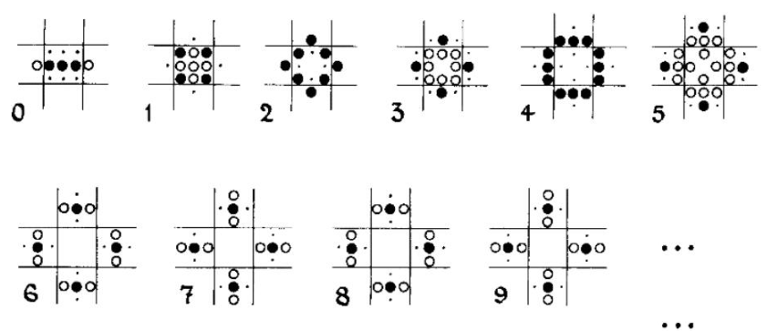
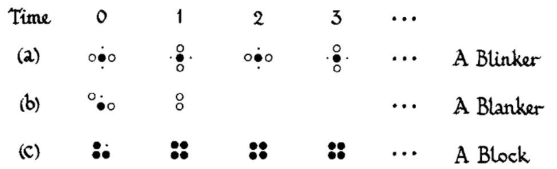
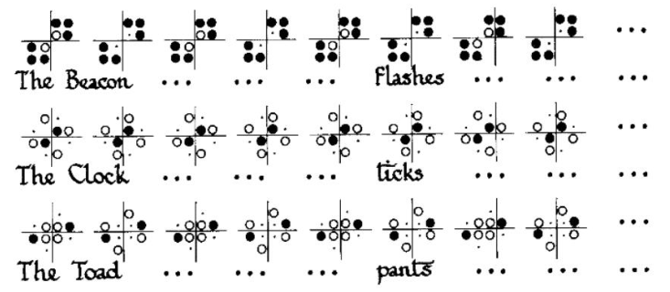
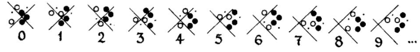

# Life is Hard and Undecidable, but...

## 题目描述

献给 John Horton Conway、他的生命游戏，以及我们正在经历的人生……

**提示：** 如果你没有耐心阅读完整背景，或者已经了解生命游戏，可直接阅读原 PDF 第三页最后一段的实际任务。

人生艰难。有些美好的梦想，你永远无法实现。有些遗憾和失去的挚爱，你却无法让时光倒流。死亡就在前方，持续带来焦虑，你却无法逃避。有些问题就摆在面前等待你解决，你却完全不知道该怎么办。


人生艰难。

人生不可判定。你永远不知道会从这盒巧克力里得到什么。经历了这些年的黑天鹅与灰犀牛事件，我们都在想：接下来会发生什么，未来又会怎样？正如长者所说，“这就是生活”（C'est la vie）。未来总是难以预料。

但生活仍要继续。我们有酒可饮，有歌可唱，有题可做，有游戏可玩。接下来要玩的就是生命游戏（Game of Life，简称 Life），它由著名英国数学家 John Horton Conway 于 1970 年提出。

生命游戏是在无限方格网格上进行的零玩家游戏。每个格子要么存活，要么死亡。第 $0$ 代哪些格子存活由你决定；之后不再需要操作，每一代的状态完全由上一代按以下规则确定：

- **诞生：** 第 $t$ 代死亡的格子，当且仅当它的 $8$ 个邻居中恰好有 $3$ 个在第 $t$ 代存活时，才会在第 $t+1$ 代存活。
- **拥挤致死：** 第 $t$ 代存活的格子，若它的 $8$ 个邻居中至少有 $4$ 个在第 $t$ 代存活，则会在第 $t+1$ 代死亡。
- **孤独致死：** 第 $t$ 代存活的格子，若它的 $8$ 个邻居中至多有 $1$ 个在第 $t$ 代存活，则会在第 $t+1$ 代死亡。
- **存活：** 第 $t$ 代存活的格子，若它的 $8$ 个邻居中有 $2$ 或 $3$ 个在第 $t$ 代存活，则会在第 $t+1$ 代继续存活。

以上规则可以记作：“恰有 $3$ 个邻居时诞生，有 $2$ 或 $3$ 个邻居时存活。”

下面的例子从排成一行的五个存活格子开始，最终变成一个周期为 $2$ 的“交通灯”图案。实心圆表示这一代存活且下一代仍存活的格子；空心圆表示这一代存活但下一代死亡的格子；小点表示这一代死亡但下一代存活的格子。以下所有插图均出自 Elwyn R. Berlekamp 与 John H. Conway 的《Winning Ways for Your Mathematical Plays》第 $4$ 卷。



一行五个存活格子演变为交通灯。

其他初始状态也会有不同的结局：



不同的开始，不同的命运。

有些初始状态会进入循环：



三种周期为 $2$ 的循环。

还有会移动的“滑翔机”：



沿对角线移动的滑翔机。

数学家和理论计算机科学家对生命游戏的奥秘着迷。他们提出：给定一个初始状态，能否判断它最终是否会完全消亡，也就是是否存在有限的某一代 $t$，使所有格子都死亡？这个问题不只是 NP-hard，甚至是不可判定的。生命游戏中的某些图案可以模拟连接两个计数器的有限状态机，而这样的机器具有与通用图灵机相同的计算能力。因此，生命游戏在理论上与具有无限内存和无限运行时间的计算机一样强大，即它是图灵完备的。人们已在生命游戏中实现了多种可编程计算机体系结构，甚至包括能模拟俄罗斯方块的图案。

虽然这意味着我们无法解开生命游戏的所有谜团，但仍然有些事情是可以做到的，其中之一就是构造。这正是本题要求你完成的：

给定一个正整数 $k$（$1\le k\le100$），请构造一个初始状态，要求所有存活格子的两个坐标均为不超过 $300$ 的正整数，并使该状态恰好持续 $k$ 代：第 $k-1$ 代仍有存活格子，第 $k$ 代则没有任何存活格子。保证至少存在一个满足条件的初始状态。

## 输入格式

输入仅包含一个整数 $k$（$1\le k\le100$），表示要求持续的代数。

## 输出格式

第一行输出一个整数 $n$（$1\le n\le90000$），表示初始状态中存活格子的数量。

接下来输出 $n$ 行，每行包含两个整数 $x,y$（$1\le x,y\le300$），表示一个初始存活格子的坐标。每个格子只能输出一次。存在多个合法初始状态时，输出任意一个即可。

### 样例 1

#### 输入

```text
1
```

#### 输出

```text
1
1 1
```

### 样例 2

#### 输入

```text
2
```

#### 输出

```text
3
100 100
101 100
102 99
```
