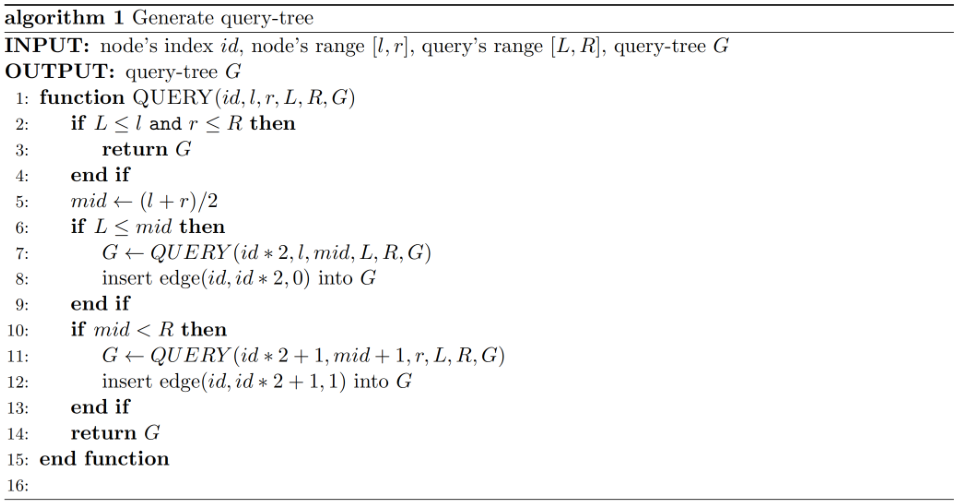
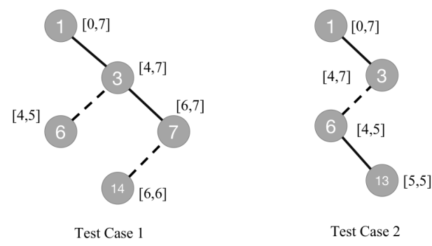

# Segment-tree

## Description

Lyra and Bon Bon are playing a segment-tree game.

Using parameters $n,L,R$, Lyra generates a query-tree $G$ by calling algorithm $1$ as $\operatorname{QUERY}(1,0,2^n-1,L,R,\varnothing)$.

The query-tree $G$ is represented by a set of edges. A tuple $(u,v,w)$ denotes an edge of value $w$ between vertices $u$ and $v$.



Algorithm $1$ takes the current node index $id$, its segment $[l,r]$, the query segment $[L,R]$ and the current query-tree $G$, and returns the updated query-tree. The algorithm in the original figure is transcribed below; midpoint division is integer division:

```text
QUERY(id, l, r, L, R, G):
    if L <= l and r <= R:
        return G
    mid = floor((l + r) / 2)
    if L <= mid:
        G = QUERY(id * 2, l, mid, L, R, G)
        insert edge (id, id * 2, 0) into G
    if mid < R:
        G = QUERY(id * 2 + 1, mid + 1, r, L, R, G)
        insert edge (id, id * 2 + 1, 1) into G
    return G
```

The two ponies take turns, and Lyra moves first.

In one move, a player chooses at least two vertices $[x_1,x_2,\ldots,x_m]$, then removes those vertices and all edges incident to them. The following restrictions apply:

1. Assume $x_1<x_2<\cdots<x_m$. For Lyra, the edges $(x_1,x_2,0),(x_2,x_3,0),\ldots,(x_{m-1},x_m,0)$ must exist in $G$. For Bon Bon, the edges $(x_i,x_{i+1},1)$ must exist instead.
2. After either player removes vertices, the query-tree must not be split into two separate components.
3. Vertex $1$ cannot be chosen unless the operation makes $G$ empty.

The player who cannot make a move loses. If both play optimally, can Lyra win?

## Input

The first line contains an integer $T$ ($1\le T\le10^6$), the number of test cases.

Each test case occupies one line with three integers $n,L,R$ ($1\le n\le61$, $0\le L\le R<2^n$), separated by spaces.

## Output

For each test case, output one line: `Yes` if Lyra wins and `No` otherwise.

## Note

The query-trees for the two sample cases are shown below:



### Sample 1

#### Input

```text
2
3 4 6
3 5 5
```

#### Output

```text
Yes
No
```
