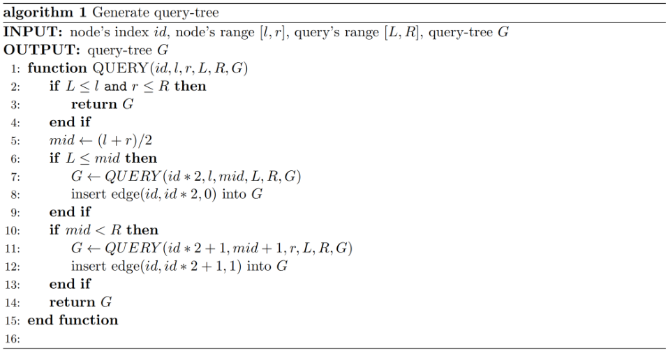
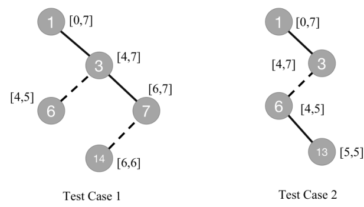

# Segment-tree

## 题目描述

Lyra 和 Bon Bon 正在玩一个线段树游戏。

Lyra 给定参数 $n,L,R$，通过调用算法 $1$ 中的 $\operatorname{QUERY}(1,0,2^n-1,L,R,\varnothing)$，生成一棵查询树 $G$。

查询树 $G$ 用一个边集表示，三元组 $(u,v,w)$ 表示顶点 $u$ 与 $v$ 之间有一条权值为 $w$ 的边。



算法 $1$ 的输入为当前节点编号 $id$、节点区间 $[l,r]$、查询区间 $[L,R]$ 和当前查询树 $G$，返回更新后的查询树。原图中的算法转写如下，其中区间中点的除法取整数商：

```text
QUERY(id, l, r, L, R, G):
    if L <= l and r <= R:
        return G
    mid = floor((l + r) / 2)
    if L <= mid:
        G = QUERY(id * 2, l, mid, L, R, G)
        insert edge (id, id * 2, 0) into G
    if mid < R:
        G = QUERY(id * 2 + 1, mid + 1, r, L, R, G)
        insert edge (id, id * 2 + 1, 1) into G
    return G
```

两匹小马轮流操作，Lyra 先手。

每次操作必须选择至少两个顶点 $[x_1,x_2,\ldots,x_m]$，然后删除这些顶点以及与它们相连的所有边，并满足以下限制：

1. 设 $x_1<x_2<\cdots<x_m$。若当前是 Lyra 操作，则 $G$ 中必须存在边 $(x_1,x_2,0),(x_2,x_3,0),\ldots,(x_{m-1},x_m,0)$；若当前是 Bon Bon 操作，则必须存在边 $(x_i,x_{i+1},1)$。
2. 无论哪位玩家删除顶点，都不能将查询树拆成两个独立的连通块。
3. 除非本次操作会使 $G$ 变为空树，否则不能选择顶点 $1$。

无法进行操作的一方输。如果双方都采取最优策略，Lyra 能否获胜？

## 输入格式

第一行包含一个整数 $T$（$1\le T\le10^6$），表示测试用例数。

每个测试用例占一行，包含三个用空格分隔的整数 $n,L,R$（$1\le n\le61$，$0\le L\le R<2^n$）。

## 输出格式

对于每个测试用例，若 Lyra 获胜则输出一行 `Yes`，否则输出一行 `No`。

## 说明

两个样例对应的查询树如下：



### 样例 1

#### 输入

```text
2
3 4 6
3 5 5
```

#### 输出

```text
Yes
No
```
