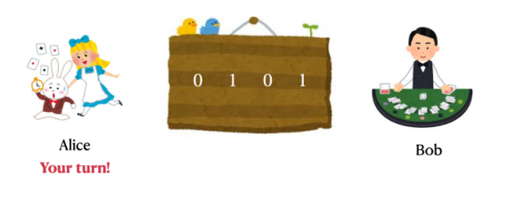
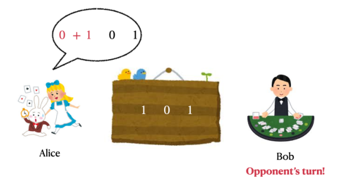
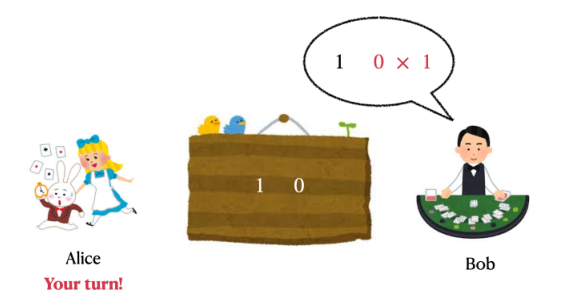
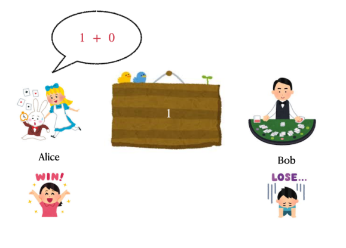

# Parity Game

## Description

**This is an interactive problem.**

Alice and Bob play a game specified by a parameter $t\in\{0,1\}$. There are $n$ integers $a_1,a_2,\ldots,a_n\in\{0,1\}$ in a row. While at least two integers remain, they take turns performing the following operation, starting with Alice:

- Choose two adjacent integers $x$ and $y$, and replace them by either $x+y$ or $x\times y$ (ordinary arithmetic addition or multiplication).

The game ends when only one integer remains. The winner depends on its parity and the parameter:

- If $t=0$, Alice wins when the remaining integer is even, and Bob wins otherwise.
- If $t=1$, Alice wins when the remaining integer is odd, and Bob wins otherwise.

Given the initial integers $a_1,a_2,\ldots,a_n$ and $t$, choose to play as Alice or Bob, then play against the interactor controlling the other role. Your goal is to win.

## Input

The first line contains two integers $n,t$ ($2\le n\le500$, $t\in\{0,1\}$), the array length and game parameter.

The second line contains $n$ integers $a_1,a_2,\ldots,a_n$ ($0\le a_i\le1$), the initial array.

## Interaction Protocol

After reading $n,t$ and the array $\{a_i\}_{1\le i\le n}$, begin by printing a line containing either `Alice` or `Bob`, selecting your role. Choosing `Alice` means you move first; otherwise you move second.

On your turn, let the current array be $b_1,b_2,\ldots,b_m$, of length $m$ ($2\le m\le n$). Output an integer $p$ ($1\le p\le m-1$) and a character $c\in\{\texttt{+},\texttt{*}\}$, separated by a space, to merge $b_p$ and $b_{p+1}$ with operator $c$. The new array is $b_1,b_2,\ldots,b_{p-1},(b_p\;c\;b_{p+1}),b_{p+2},\ldots,b_m$, of length $m-1$.

On the opponent's turn, let the array again be $b_1,b_2,\ldots,b_m$, of length $m$ ($2\le m\le n$). Read an integer $p$ ($0\le p\le m-1$) and a character $c\in\{\texttt{+},\texttt{*}\}$. They indicate that the opponent merges $b_p$ and $b_{p+1}$ using $c$, leaving the array $b_1,b_2,\ldots,b_{p-1},(b_p\;c\;b_{p+1}),b_{p+2},\ldots,b_m$ of length $m-1$. If $p=0$, your last operation was invalid. Terminate immediately to receive Wrong Answer; otherwise any verdict may result.

When one integer remains, the game is judged by the stated rule. Winning makes your program correct for this case. Losing, or making an invalid final operation when you move last, results in Wrong Answer. Terminate immediately when the game ends.

After printing your chosen role and after printing each operation, print a newline and flush the output. Otherwise you may not receive the correct verdict. Use:

- `fflush(stdout)` or `cout.flush()` in C++;
- `System.out.flush()` in Java;
- `stdout.flush()` in Python.

## Note

The blank lines in the original sample interaction only make the sequence easier to understand. Your program should not output extra blank lines.

The following illustrations show the sample interaction. For the given $\{a_i\}_{1\le i\le n}$ and $t$, choosing Alice and moving first is optimal.



The player first merges the first two integers using addition.



The opponent then merges the last two integers using multiplication.



Finally, the player merges the remaining two integers using addition and wins.



### Sample 1

#### Input

```text
4 1
0 1 0 1
2 *
```

#### Output

```text
Alice
1 +
1 +
```
