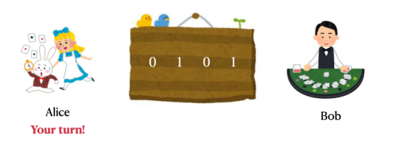
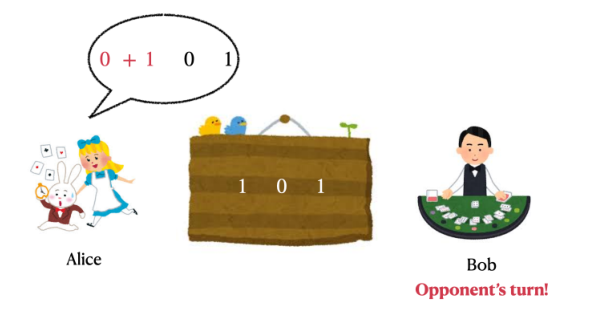
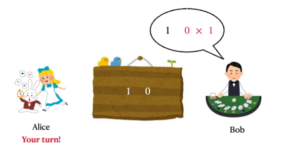
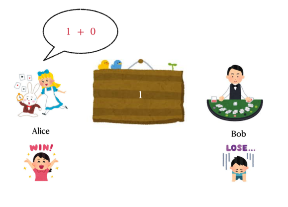

# Parity Game

## 题目描述

**这是一道交互题。**

Alice 和 Bob 玩一个由参数 $t\in\{0,1\}$ 指定的游戏。初始有 $n$ 个整数 $a_1,a_2,\ldots,a_n\in\{0,1\}$ 排成一行。只要还剩至少两个整数，双方就轮流执行以下操作，由 Alice 先手：

- 选择两个相邻整数 $x$ 和 $y$，将它们替换为 $x+y$ 或 $x\times y$，这里使用普通的算术加法或乘法。

只剩一个整数时游戏结束。胜负由该整数的奇偶性和参数决定：

- 若 $t=0$，剩余整数为偶数时 Alice 获胜，否则 Bob 获胜。
- 若 $t=1$，剩余整数为奇数时 Alice 获胜，否则 Bob 获胜。

给定初始整数 $a_1,a_2,\ldots,a_n$ 和参数 $t$，你需要选择扮演 Alice 或 Bob，再与扮演另一方的交互器进行游戏。你的目标是获胜。

## 输入格式

第一行包含两个整数 $n,t$（$2\le n\le500$，$t\in\{0,1\}$），表示数组长度和游戏参数。

第二行包含 $n$ 个整数 $a_1,a_2,\ldots,a_n$（$0\le a_i\le1$），表示初始数组。

## 交互协议

读入 $n,t$ 和数组 $\{a_i\}_{1\le i\le n}$ 后，先输出一行 `Alice` 或 `Bob` 来选择角色。选择 `Alice` 表示你先手，否则你后手。

轮到你时，设当前数组为 $b_1,b_2,\ldots,b_m$，长度为 $m$（$2\le m\le n$）。输出一个整数 $p$（$1\le p\le m-1$）和一个字符 $c\in\{\texttt{+},\texttt{*}\}$，用空格分隔，表示使用运算符 $c$ 合并 $b_p$ 与 $b_{p+1}$。操作后，数组变为 $b_1,b_2,\ldots,b_{p-1},(b_p\;c\;b_{p+1}),b_{p+2},\ldots,b_m$，长度为 $m-1$。

轮到对手时，同样设当前数组为 $b_1,b_2,\ldots,b_m$，长度为 $m$（$2\le m\le n$）。读入一个整数 $p$（$0\le p\le m-1$）和一个字符 $c\in\{\texttt{+},\texttt{*}\}$，表示对手使用 $c$ 合并 $b_p$ 与 $b_{p+1}$，操作后数组为 $b_1,b_2,\ldots,b_{p-1},(b_p\;c\;b_{p+1}),b_{p+2},\ldots,b_m$，长度为 $m-1$。若 $p=0$，则表示你上一次操作非法。此时应立即结束程序以获得 Wrong Answer，否则可能得到任何评测结果。

当数组只剩一个整数时，按题目规则判定胜负。若你获胜，则通过该测试用例；若你失败，或者最后一次操作由你执行且该操作非法，则得到 Wrong Answer。游戏结束后应立即终止程序。

输出所选角色后，以及每次输出操作后，都不要忘记换行并刷新输出缓冲区，否则可能无法获得正确的评测结果。可使用：

- C++ 中的 `fflush(stdout)` 或 `cout.flush()`；
- Java 中的 `System.out.flush()`；
- Python 中的 `stdout.flush()`。

## 说明

原稿交互样例中的额外空行仅用于方便理解执行顺序，程序不应输出多余空行。

下面用图片展示样例交互过程。对于给定的 $\{a_i\}_{1\le i\le n}$ 和 $t$，选择 Alice、作为先手是最优的。



玩家首先用加法合并前两个数。



随后，对手用乘法合并最后两个数。



最后，玩家用加法合并剩下的两个数并获胜。



### 样例 1

#### 输入

```text
4 1
0 1 0 1
2 *
```

#### 输出

```text
Alice
1 +
1 +
```
