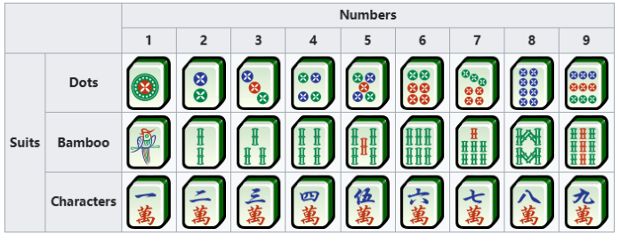
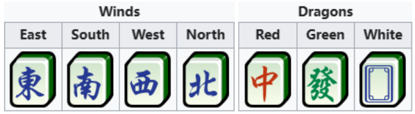
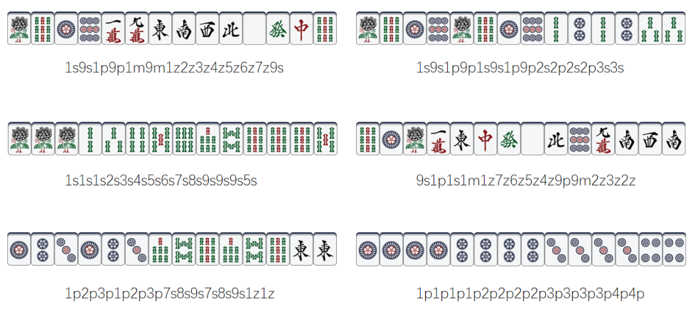

# Magic Mahjong

## Description

Starlight Glimmer is playing Magic Mahjong with her friends.

Mahjong tiles are divided into suited tiles and honors.

Suited tiles have three suits: bamboos, dots and characters. Each suit is numbered from 1 to 9, with four identical copies of every tile, for 108 suited tiles in total.



Honors are divided into winds and dragons. The winds, starting from east, are east, south, west and north; the dragons are red, green and white.



Dots are denoted by $P=\{1p,2p,3p,4p,5p,6p,7p,8p,9p\}$; similarly bamboos are $S=\{1s,2s,3s,4s,5s,6s,7s,8s,9s\}$ and characters are $M=\{1m,2m,3m,4m,5m,6m,7m,8m,9m\}$. Honors are $Z=\{1z,2z,3z,4z,5z,6z,7z\}$, in the order east, south, west, north, white, green, red.

The terminal tiles are $T=\{1p,9p,1s,9s,1m,9m\}$.

There are three kinds of winning hands in Magic Mahjong. Today Starlight Glimmer studies only the following two, both requiring 14 tiles:

- **Thirteen Orphans:** all thirteen terminal and honor tile types must each appear, together with one extra copy of any of these types. Formally, the hand is the multiset $T\cup Z\cup\{x\mid x\in T\cup Z\}$.


An example of Thirteen Orphans with two $1p$ tiles. The tiles are unordered.

- **7 Pairs:** the hand contains exactly seven distinct tile types, each appearing twice. Formally, for a set $L$ of size $7$ consisting of Mahjong tile types, the multiset $L\cup L$ is a valid hand of this kind.

Given several starting hands of 14 tiles, determine whether each hand already satisfies either winning condition above.

## Input

There are multiple test cases. The first line contains an integer $T$ ($1\le T\le1000$), the number of test cases.

Each case is a string of length 28 formed by directly concatenating the encodings of the 14 starting tiles, without spaces.

## Output

For each case, output `Thirteen Orphans` for that winning condition, `7 Pairs` for seven pairs, and `Otherwise` for every other hand.

## Note

The six hands in the sample are illustrated below:



### Sample 1

#### Input

```text
6
1s9s1p9p1m9m1z2z3z4z5z6z7z9s
1s9s1p9p1s9s1p9p2s2p2s2p3s3s
1s1s1s2s3s4s5s6s7s8s9s9s9s5s
9s1p1s1m1z7z6z5z4z9p9m2z3z2z
1p2p3p1p2p3p7s8s9s7s8s9s1z1z
1p1p1p1p2p2p2p2p3p3p3p3p4p4p
```

#### Output

```text
Thirteen Orphans
7 Pairs
Otherwise
Thirteen Orphans
7 Pairs
Otherwise
```
