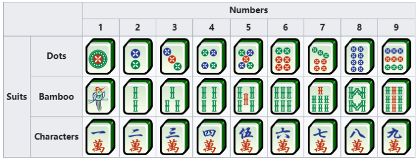
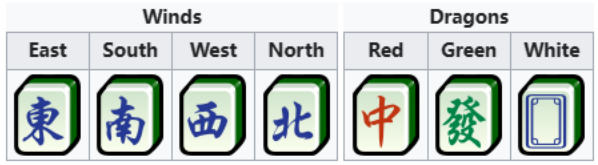
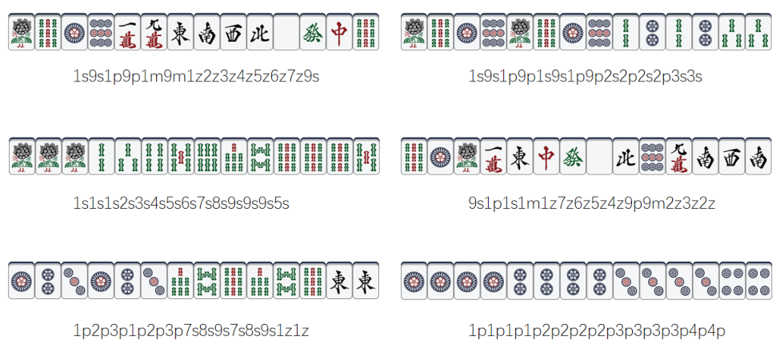

# Magic Mahjong

## 题目描述

Starlight Glimmer 正在和朋友们玩魔法麻将。

麻将牌分为数牌与字牌两类。

数牌分为条、筒、万三种花色，每种花色的数字从 1 到 9，每张牌都有四张相同的副本，数牌共计 108 张。



字牌又分为风牌与三元牌。风牌从东开始依次为东、南、西、北；三元牌为中、发、白。



筒牌记作 $P=\{1p,2p,3p,4p,5p,6p,7p,8p,9p\}$；类似地，条牌记作 $S=\{1s,2s,3s,4s,5s,6s,7s,8s,9s\}$，万牌记作 $M=\{1m,2m,3m,4m,5m,6m,7m,8m,9m\}$。字牌记作 $Z=\{1z,2z,3z,4z,5z,6z,7z\}$，依次对应东、南、西、北、白、发、中。

其中，幺九牌为 $T=\{1p,9p,1s,9s,1m,9m\}$。

魔法麻将有三种和牌牌型。今天 Starlight Glimmer 只研究下面两种，它们都需要 14 张牌：

- **十三幺（Thirteen Orphans）：** 十三种幺九牌和字牌必须各有一张，并额外有一张这十三种牌中的任意一种。形式化地说，牌组成的多重集合为 $T\cup Z\cup\{x\mid x\in T\cup Z\}$。


上图是一个有两张 $1p$ 的十三幺牌型。牌的顺序不影响牌型。

- **七对子（7 Pairs）：** 手牌中恰有七种不同的牌，每种牌出现两次。形式化地说，对于一个由麻将牌种类构成、大小为 $7$ 的集合 $L$，多重集合 $L\cup L$ 就是合法的七对子。

现在给出若干组各有 14 张牌的初始手牌，请判断它们是否已经满足上述某种和牌条件。

## 输入格式

有多组测试数据。第一行包含一个整数 $T$（$1\le T\le1000$），表示测试用例数。

每个测试用例包含一个长度为 28 的字符串，由 14 张初始手牌的编码直接拼接而成，中间没有空格。

## 输出格式

对于每个测试用例，若为十三幺，则输出 `Thirteen Orphans`；若为七对子，则输出 `7 Pairs`；否则输出 `Otherwise`。

## 说明

样例中的六组手牌如下：



### 样例 1

#### 输入

```text
6
1s9s1p9p1m9m1z2z3z4z5z6z7z9s
1s9s1p9p1s9s1p9p2s2p2s2p3s3s
1s1s1s2s3s4s5s6s7s8s9s9s9s5s
9s1p1s1m1z7z6z5z4z9p9m2z3z2z
1p2p3p1p2p3p7s8s9s7s8s9s1z1z
1p1p1p1p2p2p2p2p3p3p3p3p4p4p
```

#### 输出

```text
Thirteen Orphans
7 Pairs
Otherwise
Thirteen Orphans
7 Pairs
Otherwise
```
