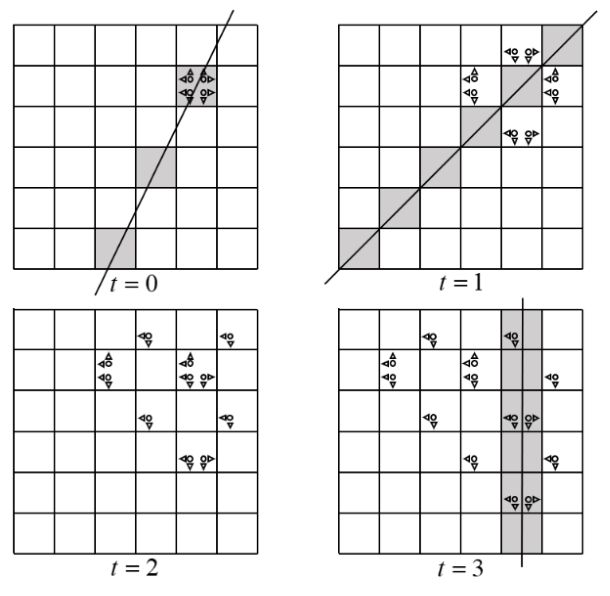

# Bouncing Particles

Time limit: 2 seconds. Memory limit: 1024 megabytes. Standard input and output.

**This problem has an attachment for simulating and visualizing particle movement.**

VegiCat observes particles on a grid of $n$ rows and $n$ columns. The lower-left cell is $(1,1)$; horizontal coordinates increase to the right and vertical coordinates upwards. Each particle has a horizontal direction, left or right, and a vertical direction, up or down. At the beginning of each step:

- Reverse its horizontal direction if the next cell in that direction would be outside the grid.
- Reverse its vertical direction if the next cell in that direction would be outside the grid.

After these adjustments, a particle at $(x,y)$ produces two children:

- One at $(x-1,y)$ if its horizontal direction is left, or $(x+1,y)$ if right.
- One at $(x,y-1)$ if its vertical direction is down, or $(x,y+1)$ if up.

Both children inherit both adjusted directions, and the parent disappears. Any number of particles may occupy the same cell, regardless of direction. They do not interact or change one another's directions.

At time $0$, four particles are at $(x_0,y_0)$, with direction pairs:

- right and up;
- left and up;
- right and down;
- left and down.

At each step, all particles simultaneously adjust directions and split as described.

There are $q$ queries. Each gives integers $A,B,C$ and a time $t$. Find the number of grid cells $(x,y)$ satisfying $Ax+By+C=0$ that contain at least one particle at time $t$.

## Input Format

The first line contains $T$ ($1\le T\le10^5$), the number of test cases.

The first line of each test case contains $n,x_0,y_0,q$ ($2\le n\le10^9$, $1\le x_0,y_0\le n$, $1\le q\le10^5$), describing the grid size, initial cell and query count. Each of the next $q$ lines contains $A,B,C,t$ ($|A|,|B|,|C|\le10^9$, $0\le t\le10^9$). It asks about the line $Ax+By+C=0$ at time $t$. The values $A$ and $B$ are not both $0$.

The sum of $q$ over all test cases does not exceed $10^5$.

## Output Format

For each query, output one integer on a line: the number of grid cells $(x,y)$ satisfying $Ax+By+C=0$ and containing at least one particle at time $t$.

## Sample Explanation

The figure shows the sample's particle evolution and queried lines. Gray cells represent cells whose integer-coordinate points lie on the queried line. All splitting directions have been adjusted to stay inside the grid. The third query's line is far from the grid and is omitted.




## Sample 1

### Input

```text
1
6 5 5 4
2 -1 -5 0
1 -1 0 1
11 45 14 2
1 0 -5 3
```

### Output

```text
1
0
0
3
```
