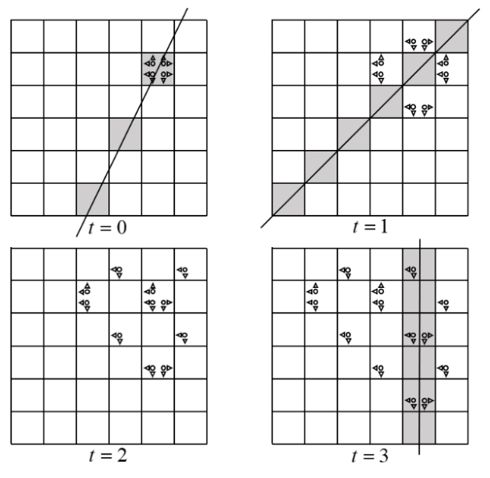

# 弹跳粒子

时间限制：2 秒。内存限制：1024 MB。使用标准输入和标准输出。

**本题有附件，可以用来模拟并可视化粒子的运动。**

VegiCat 观察一个 $n$ 行、$n$ 列网格上的粒子。左下角格子坐标为 $(1,1)$，横坐标向右增大，纵坐标向上增大。每个粒子有一个水平方向，即左或右，以及一个竖直方向，即上或下。每步开始时：

- 如果沿水平方向的下一个格子在网格外，则将水平方向反转。
- 如果沿竖直方向的下一个格子在网格外，则将竖直方向反转。

调整完成后，位于 $(x,y)$ 的粒子产生两个子粒子：

- 如果水平方向向左，其中一个位于 $(x-1,y)$；否则位于 $(x+1,y)$。
- 如果竖直方向向下，另一个位于 $(x,y-1)$；否则位于 $(x,y+1)$。

两个子粒子都继承父粒子调整后的水平和竖直方向，随后父粒子消失。不论方向如何，任意多个粒子可以同时位于同一个格子，它们不会相互作用，也不会改变彼此的方向。

时刻 $0$，点 $(x_0,y_0)$ 上有四个粒子，方向组合分别为：

- 右、上；
- 左、上；
- 右、下；
- 左、下。

每一步，所有粒子同时按上述规则调整方向并分裂。

共有 $q$ 次询问，每次给出整数 $A,B,C$ 和时刻 $t$。求满足 $Ax+By+C=0$，且在时刻 $t$ 至少包含一个粒子的网格格子 $(x,y)$ 的数量。

## 输入格式

第一行包含测试用例数 $T$（$1\le T\le10^5$）。

每个测试用例的第一行包含 $n,x_0,y_0,q$（$2\le n\le10^9$，$1\le x_0,y_0\le n$，$1\le q\le10^5$），分别描述网格大小、初始格子和询问数量。接下来 $q$ 行，每行包含 $A,B,C,t$（$|A|,|B|,|C|\le10^9$，$0\le t\le10^9$），询问时刻 $t$ 的直线 $Ax+By+C=0$。保证 $A$ 和 $B$ 不同时为 $0$。

所有测试用例的 $q$ 之和不超过 $10^5$。

## 输出格式

对于每次询问，在一行中输出一个整数，表示满足 $Ax+By+C=0$，且在时刻 $t$ 至少包含一个粒子的格子 $(x,y)$ 的数量。

## 样例说明

下图展示样例中的粒子演化和询问直线。灰色格子表示其整数坐标点位于询问直线上的格子。图中所有分裂方向都已调整为合法方向。第三次询问的直线距离网格过远，因此未在图中绘出。




## 样例 1

### 输入

```text
1
6 5 5 4
2 -1 -5 0
1 -1 0 1
11 45 14 2
1 0 -5 3
```

### 输出

```text
1
0
0
3
```
