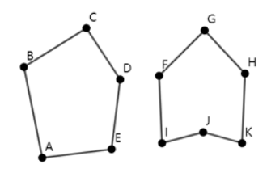

# Concave Hull

Time limit: 1 second. Memory limit: 1024 megabytes. Standard input and output.

A simple polygon is a closed curve in the Euclidean plane formed by straight segments joined end to end. Exactly two segments meet at each endpoint, and the segments have no other intersections.

A simple polygon is convex if, for any two points inside it, the entire segment between them lies in its interior or on its boundary. A simple polygon that is not convex is concave. The figure shows a convex polygon on the left and a concave polygon on the right.



Given $n$ distinct points with no three collinear, select some of them, possibly all, and connect the selected points in any order to form a concave polygon with strictly positive area. Determine the maximum possible area.

## Input Format

The first line contains $T$ ($1\le T\le10^4$), the number of test cases. For each test case, the first line contains $n$ ($3\le n\le10^5$), the number of points. The next $n$ lines each contain integers $x_i,y_i$ ($-10^9\le x_i,y_i\le10^9$), the coordinates of a point.

All points are distinct and no three are collinear. The sum of $n$ over all test cases does not exceed $2\cdot10^5$.

## Output Format

For each test case, output $-1$ if no concave polygon of strictly positive area can be formed. Otherwise, output a positive integer equal to twice the maximum possible area. This value is always a positive integer.


## Sample 1

### Input

```text
2
6
-2 0
1 -2
5 2
0 4
1 2
3 1
4
0 0
1 0
0 1
1 1
```

### Output

```text
40
-1
```
