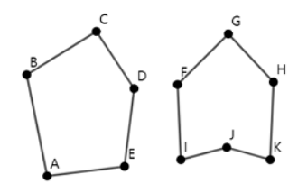

# 凹包

时间限制：1 秒。内存限制：1024 MB。使用标准输入和标准输出。

简单多边形是欧几里得平面上由线段首尾相接形成的闭合曲线。每个端点处恰好有两条线段相接，除此之外，线段之间没有其他交点。

如果对于多边形内部的任意两点，连接它们的整条线段都位于多边形内部或边界上，就称该简单多边形为凸多边形。不是凸多边形的简单多边形称为凹多边形。下图左侧为凸多边形，右侧为凹多边形。



给定 $n$ 个互不相同且任意三点不共线的点，从中选择一些点，也可以全部选择，并按任意顺序连接，使其形成面积严格为正的凹多边形。求能够得到的最大面积。

## 输入格式

第一行包含测试用例数 $T$（$1\le T\le10^4$）。对于每个测试用例，第一行包含点数 $n$（$3\le n\le10^5$）。接下来 $n$ 行，每行包含两个整数 $x_i,y_i$（$-10^9\le x_i,y_i\le10^9$），表示一个点的坐标。

所有点互不相同，且任意三点不共线。所有测试用例的 $n$ 之和不超过 $2\cdot10^5$。

## 输出格式

对于每个测试用例，如果无法构造面积严格为正的凹多边形，输出 $-1$。否则输出一个正整数，表示所能构造的凹多边形最大面积的两倍。可以证明，这个值总是正整数。


## 样例 1

### 输入

```text
2
6
-2 0
1 -2
5 2
0 4
1 2
3 1
4
0 0
1 0
0 1
1 1
```

### 输出

```text
40
-1
```
