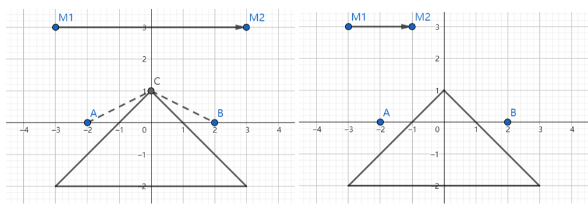

# Mirror

Time limit: 15 seconds. Memory limit: 1024 megabytes. Standard input and output.

There is an opaque triangular obstacle and a single-sided mirror in an infinite two-dimensional plane. The mirror is a directed line segment from $(x_{m,1},y_{m,1})$ to $(x_{m,2},y_{m,2})$, with its right side reflective.

There are $m$ stones at $(x_1,y_1)$. DreamGrid wants to move all of them to $(x_2,y_2)$ subject to these constraints:

- He can carry only one stone at a time.
- Once he picks up a stone, he can put it down only at $(x_2,y_2)$.
- Let $L$ be his walking path. At every point $p$ on $L$, he must be able to see all stones, either directly or through the mirror.

Note the following rules:

- A line of sight is blocked if any part lies inside the obstacle. Merely passing through a vertex or along an edge is allowed.
- If an endpoint of the mirror lies on a line of sight, he can see the stone both in the mirror and through the mirror.
- Reflection obeys physical laws: the angles of incidence and reflection are equal, and the incident and reflected rays lie in the same half-plane relative to the mirror.
- A line of sight parallel to the mirror is not reflected, and the mirror does not block that line of sight.
- He cannot enter the obstacle, but may walk along its edges and vertices.
- He cannot cross the mirror, but may walk on it. At an interior point of the mirror segment, he can see only the side from which he arrived and cannot see through the mirror.

Find the shortest distance he must walk to move all stones from $(x_1,y_1)$ to $(x_2,y_2)$.

## Input Format

There are multiple test cases. The first line contains their number $T$, about $100$.

For each test case, the first line contains $m$ ($1\le m\le10^6$), the number of stones. The second line contains $x_1,y_1,x_2,y_2$, the start and target coordinates. The third line contains $x_{m,1},y_{m,1},x_{m,2},y_{m,2}$, the mirror's endpoints. Each of the next $3$ lines contains two integers $x_i,y_i$, specifying a vertex of the obstacle.

All coordinates are integers with absolute value at most $100$. The start and target are outside the obstacle and the mirror. The mirror and obstacle have no common points. No three given points are collinear.

## Output Format

For each test case, output the shortest distance as a real number, or $-1$ if the stones cannot all be moved under the constraints. An answer is accepted if its absolute or relative error is less than $10^{-6}$.

## Sample Explanation

Our special guest Mashiro, who contributed this problem, explains the examples with her sketchbook.



The start is $A$, the target is $B$, and the mirror points from $M1$ to $M2$, with its right side reflective. For the first example, the optimal path is $A\to C\to B\to C\to A\to C\to B$. For the second example, DreamGrid cannot see $A$ from $B$, so it is impossible to move both stones from $A$ to $B$ while satisfying the constraints.


## Sample 1

### Input

```text
2
2
-2 0 2 0
-3 3 3 3
0 1
-3 -2
3 -2
2
-2 0 2 0
-3 3 -1 3
0 1
-3 -2
3 -2
```

### Output

```text
13.416407864999
-1
```
