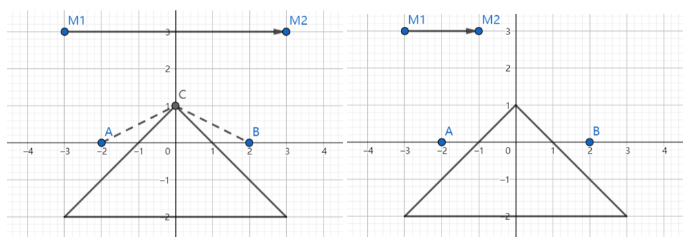

# 镜子

时间限制：15 秒。内存限制：1024 MB。使用标准输入和标准输出。

无限大的二维平面上有一个不透明的三角形障碍物和一面单面镜。镜子是一条从 $(x_{m,1},y_{m,1})$ 指向 $(x_{m,2},y_{m,2})$ 的有向线段，其右侧为反光面。

点 $(x_1,y_1)$ 处有 $m$ 块石头。DreamGrid 希望把它们全部搬到 $(x_2,y_2)$，并满足以下条件：

- 每次只能搬运一块石头。
- 一旦拿起一块石头，就只能在 $(x_2,y_2)$ 将其放下。
- 令 $L$ 表示他走过的路径。在 $L$ 上的每一点 $p$，他都必须能直接或通过镜子看到全部石头。

请注意以下规则：

- 如果一条视线有任意部分位于障碍物内部，则该视线被阻挡。视线仅经过障碍物的顶点或沿着边经过是允许的。
- 如果镜子的某个端点位于视线上，则既可以在镜中看到石头，也可以透过镜子看到石头。
- 反射遵守物理规律：入射角等于反射角，入射光线和反射光线位于镜子所在直线的同一侧。
- 若视线与镜子平行，则不发生反射，且镜子不阻挡这条视线。
- 他不能走进障碍物内部，但可以在障碍物的边和顶点上行走。
- 他不能穿过镜子，但可以走到镜子上。如果他位于镜子线段的内部，即不在两个端点上，就只能看到自己来时的那一侧，不能透过镜子看到另一侧。

求将所有石头从 $(x_1,y_1)$ 搬到 $(x_2,y_2)$ 所需行走的最短距离。

## 输入格式

有多组测试数据。第一行包含测试用例数 $T$，约为 $100$。

对于每个测试用例，第一行包含石头数量 $m$（$1\le m\le10^6$）。第二行包含 $x_1,y_1,x_2,y_2$，表示起点和终点坐标。第三行包含 $x_{m,1},y_{m,1},x_{m,2},y_{m,2}$，表示镜子两个端点的坐标。接下来 $3$ 行，每行包含两个整数 $x_i,y_i$，描述障碍物的一个顶点。

所有坐标均为绝对值不超过 $100$ 的整数。起点和终点均不位于障碍物或镜子上。镜子和障碍物没有公共点。保证给出的点中任意三点不共线。

## 输出格式

对于每个测试用例，输出一个实数，表示最短距离。如果无法在满足条件的前提下搬完所有石头，则输出 $-1$。答案的绝对误差或相对误差小于 $10^{-6}$ 即可被接受。

## 样例说明

为本题提供题目的特邀嘉宾 Mashiro 用她的速写本解释样例。



图中，起点为 $A$，终点为 $B$；镜子从 $M1$ 指向 $M2$，右侧为反光面。第一组样例的最优路径为 $A\to C\to B\to C\to A\to C\to B$。第二组样例中，DreamGrid 在 $B$ 处无法看到 $A$，所以不可能在遵守题目条件的情况下，将两块石头全部从 $A$ 搬到 $B$。


## 样例 1

### 输入

```text
2
2
-2 0 2 0
-3 3 3 3
0 1
-3 -2
3 -2
2
-2 0 2 0
-3 3 -1 3
0 1
-3 -2
3 -2
```

### 输出

```text
13.416407864999
-1
```
