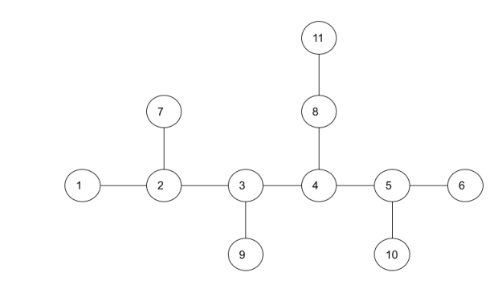
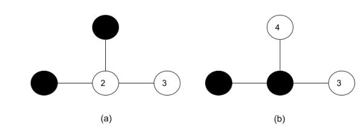
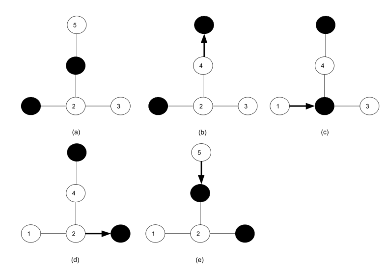
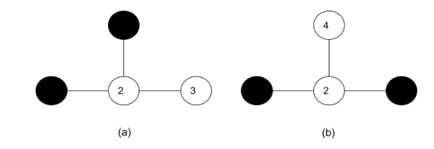

# Chemical Storage

Time limit: 1 second. Memory limit: 1024 megabytes.

## Problem Description

The International Chemical Producing Company (ICPC) stores chemicals in rooms connected by short railroads along which chemicals can be moved. This network is a tree with a central path such that every node is within distance $2$ of that path. Rooms are labelled consecutively starting from $1$. Figure 1 shows an example.



Each chemical product is stored in a tank placed in a room. Because chemicals may leak and react adversely, two adjacent rooms cannot both contain chemicals. Figure 2 shows a safe placement in (a) and an unsafe placement in (b).



Workers sometimes need to clean tanks and move chemicals to other rooms. Peter receives a source placement $T_s$ and a destination placement $T_d$, both satisfying the safety rule. The task is feasible if chemicals can be moved along the railroads from $T_s$ to $T_d$ while always obeying the safety rule; otherwise it is infeasible. Chemicals need not reach individually specified rooms: only the set of occupied rooms in the destination matters. If $T_s$ and $T_d$ are identical, the task is feasible.

Figure 3 gives a feasible task: (a) is the source; (b) moves the chemical in room $4$ to room $5$; (c) moves the chemical in room $1$ to room $2$; (d) moves the chemical in room $2$ to room $3$; and (e) moves the chemical in room $5$ to room $4$, reaching the destination.



Figure 4 gives an infeasible task, with source (a) and destination (b).



Write a program to determine whether each task is feasible.

## Input Format

The first line contains the number of test cases $t$. Each test case consists of four lines:

1. Two integers $n$ and $m$, the numbers of rooms and chemical tanks.
2. $n-1$ integers $r_1,r_2,\ldots,r_{n-1}$. For every $1\le i\le n-1$, a railroad connects room $i+1$ to room $r_i$.
3. $m$ integers $s_j$, for $1\le j\le m$, the occupied rooms in the source placement.
4. $m$ integers $d_k$, for $1\le k\le m$, the occupied rooms in the destination placement.

## Output Format

For each test case, output $1$ on a line if the task is feasible, and $0$ otherwise.

## Technical Specification

- $5\le t\le10$.
- $1\le m\le n\le10000$.
- $1\le r_i<i+1$ for $1\le i\le n-1$.
- $1\le s_j\le n$ and $s_p\ne s_q$ if $p\ne q$.
- $1\le d_j\le n$ and $d_p\ne d_q$ if $p\ne q$.
- Both given placements satisfy the safety rule.


## Sample 1

### Input

```text
6
4 2
1 2 2
1 4
3 4
4 2
1 2 2
1 4
1 4
5 2
1 2 2 4
1 4
3 4
11 4
1 2 3 4 5 2 4 3 5 8
1 6 7 8
1 3 5 8
11 4
1 2 3 4 5 2 4 3 5 8
1 3 5 8
7 8 9 10
10 5
1 2 3 4 2 3 3 6 4
2 4 7 8 9
1 5 6 7 8
```

### Output

```text
0
1
1
0
1
1
```
