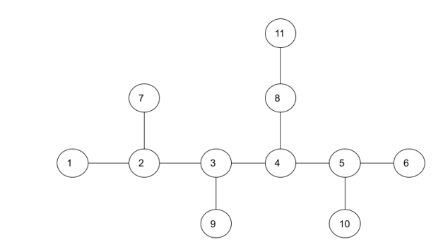
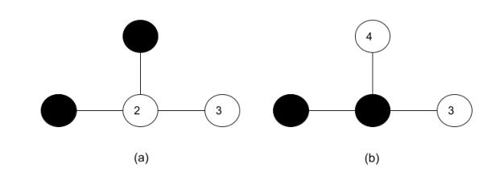
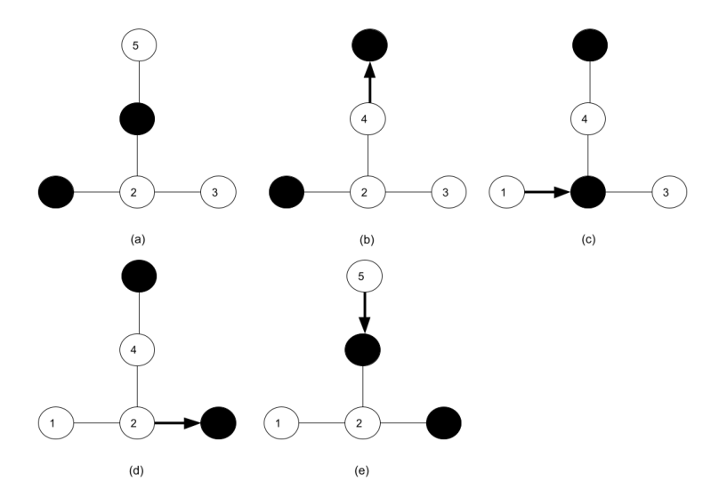
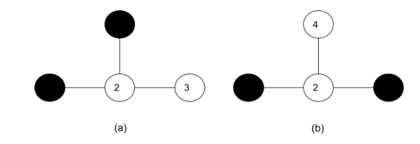

# 化学品存储

时间限制：1 秒。内存限制：1024 MB。

## 题目描述

国际化学品生产公司（ICPC）将化学品储存在一些房间中，并用短铁路连接房间，以便沿铁路移动化学品。房间和铁路组成一棵特殊的树：存在一条中心路径，每个结点到该路径的距离都不超过 $2$。房间从 $1$ 开始连续编号。图 1 给出了一个例子。



每种化学品储存在放于房间内的储罐中。由于化学品可能泄漏并发生不良化学反应，安全规则规定：两个相邻房间不能同时存放化学品。图 2 中，(a) 是安全的放置方式，(b) 是不安全的放置方式。



工人有时需要清洗储罐，并将化学品移到其他房间。Peter 接到的任务包含一个初始放置状态 $T_s$ 和一个目标放置状态 $T_d$，两者都满足安全规则。如果能够沿铁路移动化学品，从 $T_s$ 到达 $T_d$，并在整个过程中始终遵守安全规则，就称任务可行；否则称任务不可行。每份化学品并不需要到达单独指定的房间，只需要最终有化学品的房间集合与目标一致。如果 $T_s$ 与 $T_d$ 相同，任务也视为可行。

图 3 展示了一个可行任务：(a) 是初始状态；(b) 将房间 $4$ 的化学品移到房间 $5$；(c) 将房间 $1$ 的化学品移到房间 $2$；(d) 将房间 $2$ 的化学品移到房间 $3$；(e) 将房间 $5$ 的化学品移到房间 $4$，到达目标状态。



图 4 展示了一个不可行任务，其中 (a) 是初始状态，(b) 是目标状态。



请编写程序，判断每个任务是否可行。

## 输入格式

第一行包含测试用例数 $t$。每个测试用例占四行：

1. 两个整数 $n$ 和 $m$，分别表示房间数量和化学品储罐数量。
2. $n-1$ 个整数 $r_1,r_2,\ldots,r_{n-1}$。对于每个 $1\le i\le n-1$，房间 $i+1$ 与房间 $r_i$ 之间有一条铁路。
3. $m$ 个整数 $s_j$，其中 $1\le j\le m$，表示初始状态下存放化学品的房间编号。
4. $m$ 个整数 $d_k$，其中 $1\le k\le m$，表示目标状态下存放化学品的房间编号。

## 输出格式

对于每个测试用例，若任务可行，在一行中输出 $1$；否则输出 $0$。

## 数据范围

- $5\le t\le10$。
- $1\le m\le n\le10000$。
- 对于 $1\le i\le n-1$，有 $1\le r_i<i+1$。
- $1\le s_j\le n$，且当 $p\ne q$ 时有 $s_p\ne s_q$。
- $1\le d_j\le n$，且当 $p\ne q$ 时有 $d_p\ne d_q$。
- 给定的初始状态和目标状态都满足安全规则。


## 样例 1

### 输入

```text
6
4 2
1 2 2
1 4
3 4
4 2
1 2 2
1 4
1 4
5 2
1 2 2 4
1 4
3 4
11 4
1 2 3 4 5 2 4 3 5 8
1 6 7 8
1 3 5 8
11 4
1 2 3 4 5 2 4 3 5 8
1 3 5 8
7 8 9 10
10 5
1 2 3 4 2 3 3 6 4
2 4 7 8 9
1 5 6 7 8
```

### 输出

```text
0
1
1
0
1
1
```
