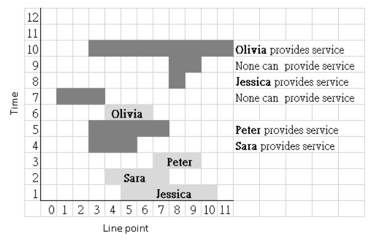

# Community Service

Time limit: 3 seconds. Memory limit: 1024 megabytes.

## Problem Description

ICPC (International-Competition Partner Community) is an emerging community. Its young, competitive residents are willing to serve their community. They live on a straight-line street whose points have integer addresses from $0$ to $n-1$, where $1\le n\le10^6$.

Young people move into ICPC one after another. Every newcomer must provide community service once. Each newcomer chooses an interval $[a,b]$, with $0\le a\le b<n$, containing the points where they are interested in serving. When the community center requests service in an interval $[c,d]$, with $0\le c\le d<n$, the newest newcomer whose chosen interval intersects the requested interval and who has not already provided service must serve. After providing service, that resident has no further obligation.

You are given the number of points $n$ and a sequence of events in chronological order. There are two types of events.

- A newcomer event has the form `1 name a b`. Here `name` is the newcomer's name, without spaces, and $a$ and $b$ satisfy $0\le a\le b<n$. All points from $a$ through $b$, inclusive, belong to this newcomer's chosen service area.
- A service-request event has the form `2 c d`. Here $c$ and $d$ satisfy $0\le c\le d<n$. The community center requests service at all points from $c$ through $d$, inclusive.

Process these events. For each service request, report the newest eligible newcomer's name. If every resident with an intersecting interval has already served, or no resident has chosen an intersecting interval, report `>_<`.

The following original figure illustrates the sample events at successive times. A light-gray bar with a name shows a newcomer's chosen interval, and a dark-gray bar shows a service-request interval.



## Input Format

The first line contains two integers $n$ and $e$, where $1\le n\le10^6$ and $1\le e\le200000$. They are the number of street points and the number of events. The following $e$ lines describe the events in chronological order, using the formats above.

## Output Format

For each service request, output the name of the resident who provides service, or `>_<` if no resident is available. Different residents may have the same name; they are still different people.

## Technical Specification

- $1\le n\le10^6$.
- $1\le e\le200000$.
- $0\le a\le b<n$.
- $0\le c\le d<n$.
- Every newcomer's name consists of letters without spaces and has length at most 16.

## Sample 1

### Input

```text
12 10
1 Jessica 5 10
1 Sara 4 7
1 Peter 7 9
2 3 5
2 3 7
1 Olivia 4 6
2 1 3
2 8 8
2 8 9
2 3 11
```

### Output

```text
Sara
Peter
>_<
Jessica
>_<
Olivia
```
