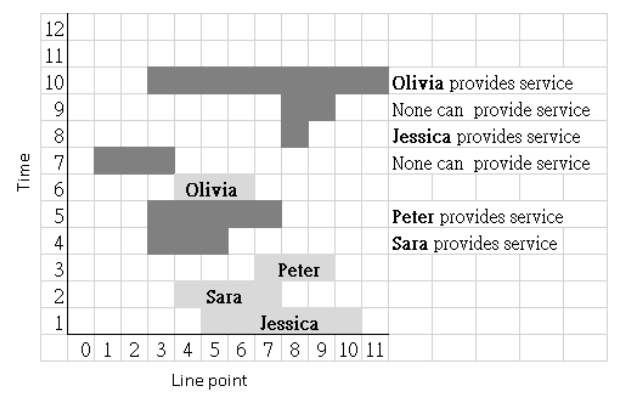

# 社区服务

时间限制：3 秒。内存限制：1024 兆字节。

## 题目描述

ICPC（International-Competition Partner Community）是一个新兴社区。这里的居民年轻、富有竞争精神，也愿意为社区服务。居民住在一条笔直的街道上，街道上的位置用从 $0$ 到 $n-1$ 的整数编号，其中 $1\le n\le10^6$。

年轻人陆续搬入 ICPC。每位新居民都必须提供一次社区服务。每个人选择一个区间 $[a,b]$，满足 $0\le a\le b<n$，表示自己愿意服务的位置。当社区中心对区间 $[c,d]$（$0\le c\le d<n$）提出服务请求时，在所选区间与请求区间有交集、且尚未提供过服务的居民中，由最后搬入社区的那个人提供服务。提供过一次服务后，该居民就不再需要服务。

给定街道位置数 $n$，以及按时间先后排列的一系列事件。事件分为两种。

- 新居民事件，格式为 `1 name a b`。其中 `name` 是不含空格的居民姓名，$a$ 和 $b$ 满足 $0\le a\le b<n$。从 $a$ 到 $b$（含两端）的所有位置都属于该居民选择的服务范围。
- 服务请求事件，格式为 `2 c d`。其中 $c$ 和 $d$ 满足 $0\le c\le d<n$。社区中心对从 $c$ 到 $d$（含两端）的所有位置提出服务请求。

请依次处理这些事件。对于每次服务请求，报告符合条件且最后搬入的居民姓名。如果所有服务范围与请求区间相交的居民都已经服务过，或者没有人选择过与请求区间相交的范围，则报告 `>_<`。

下面的原稿配图按时间展示样例中的事件。标有姓名的浅灰色条表示新居民选择的服务区间，深灰色条表示服务请求区间。



## 输入格式

第一行包含两个整数 $n$ 和 $e$，满足 $1\le n\le10^6$、$1\le e\le200000$，分别表示街道位置数和事件数。接下来 $e$ 行按时间先后描述事件，格式如上。

## 输出格式

对于每个服务请求，输出提供服务的居民姓名；若没有可提供服务的居民，则输出 `>_<`。不同居民可以同名，但仍视为不同的人。

## 数据范围

- $1\le n\le10^6$。
- $1\le e\le200000$。
- $0\le a\le b<n$。
- $0\le c\le d<n$。
- 每位新居民的姓名只包含字母、不含空格，长度不超过 16。

## 样例 1

### 输入

```text
12 10
1 Jessica 5 10
1 Sara 4 7
1 Peter 7 9
2 3 5
2 3 7
1 Olivia 4 6
2 1 3
2 8 8
2 8 9
2 3 11
```

### 输出

```text
Sara
Peter
>_<
Jessica
>_<
Olivia
```
